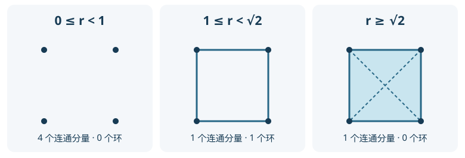
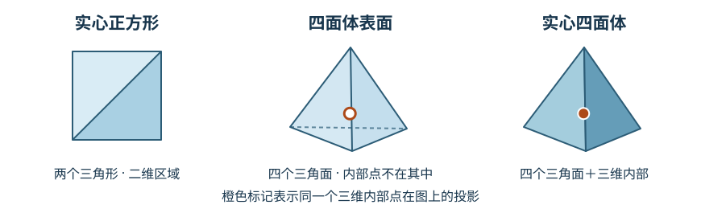
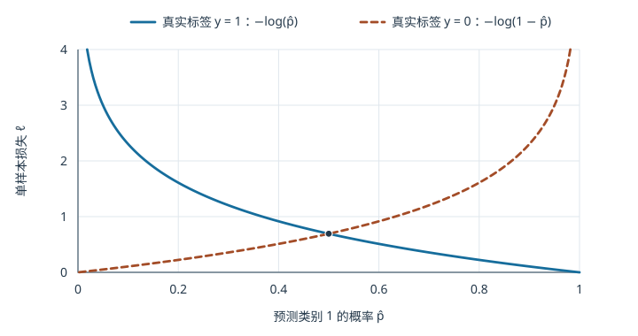
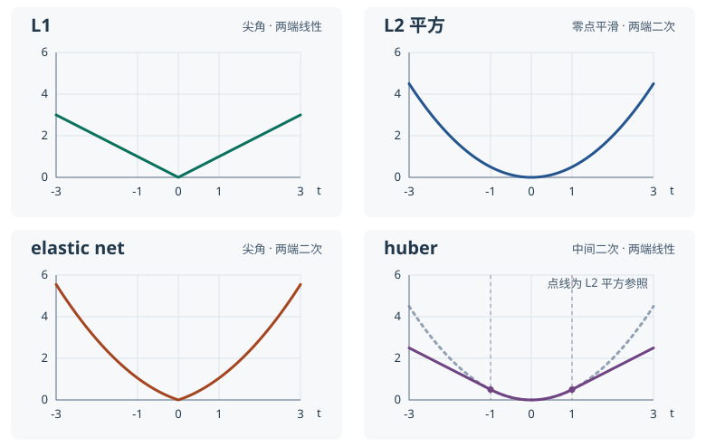
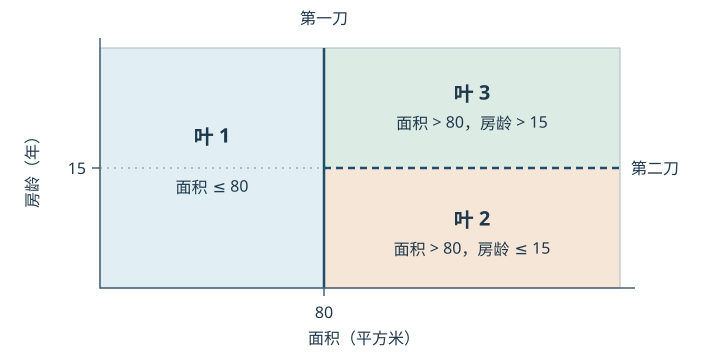
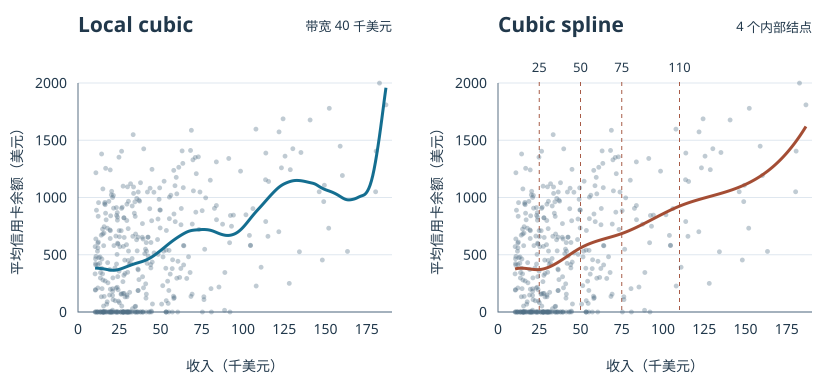

# 1 Statistical Learning Booklet

> Predictors predict prediction of response.

| Term | Notation |
| :--- | :--- |
| `predictors` | $x$ |
| `predicting` | $\hat f$ |
| `prediction` | $\hat y=\hat f(x)$ |
| `response` | $y$ |

表示概念的下标用小写字段缩写，例如 `exc`（excess，超额）、`obs`（observed，观测）和 `frob`（Frobenius）。样本编号、时间、坐标、阶数以及用来指定对象的数学符号沿用各节定义，例如 $M_X$ 中的 $X$。金融面板数据统一采用 $y_{t,i}$，时间索引 $t$ 在前，「证券」（`instrument`）索引 $i$ 在后。

## 1.1 组合计数

### 从不同对象中选取

设有 $n\ge 1$ 个可区分对象，选取 $k\ge 0$ 个。有放回时同一对象可重复选取。

| 从 $n$ 个对象中选 $k$ 个 | 有放回 | 无放回 |
| :--- | :---: | :---: |
| 计顺序 | $n^k$ | $n^{(k)}$ |
| 不计顺序 | $\binom{n+k-1}{k}$ | $\binom{n}{k}$ |

### 按类型选取

设有 $t\ge 1$ 种类型，第 $i$ 种有 $n_i\ge 1$ 个对象。同类型的对象视为相同。有放回时每类可重复选取，无放回时每类最多选 $n_i$ 个。选 $k\ge 0$ 个时，记无放回的可行计数向量集合为

$$
\mathcal A_k=\lbrace(a_1,\ldots,a_t)\in\mathbb Z_{\ge 0}^t : a_1+\cdots+a_t=k,\ a_i\le n_i\text{ 对所有 }i\rbrace.
$$

| 按类型选 $k$ 个 | 有放回 | 无放回 |
| :--- | :---: | :---: |
| 计顺序 | $t^k$ | $\displaystyle\sum_{\mathbf a\in\mathcal A_k}\binom{k}{a_1,\ldots,a_t}$ |
| 不计顺序 | $\binom{t+k-1}{k}$ | $\lvert\mathcal A_k\rvert=[z^k]\prod_{i=1}^t(1+z+\cdots+z^{n_i})$ |

$[z^k]$ 表示取 $z^k$ 的系数。也可用容斥公式计算：

$$
\lvert\mathcal A_k\rvert=\sum_{J\subseteq\lbrace 1,\ldots,t\rbrace}(-1)^{\lvert J\rvert}
\binom{k+t-1-\sum_{j\in J}(n_j+1)}{t-1}.
$$

若二项式系数的上参数小于下参数，该项取 $0$。

### Bell 数

$B_n$ 表示将 $n$ 个可区分元素划分成若干非空块的方法数。各块互不相交，合起来包含所有元素，块的顺序无关。空集有一种划分，所以 $B_0=1$。

$$
B_{n+1}=\sum_{k=0}^{n}\binom{n}{k}B_k,\qquad n\ge 0.
$$

固定一个元素。从其余 $n$ 个元素中选出 $k$ 个留在该元素所在块之外，这 $k$ 个元素有 $B_k$ 种划分方式。对所有 $k$ 求和即得递推式。

## 1.2 概率分布

### 分布的定义

随机变量 $X$ 的「分布」（`distribution`）是它在取值空间上诱导的概率测度。对取值空间中的任意可测集合 $A$，定义

$$
P_X(A)=\mathbb P(X\in A)
=\mathbb P\bigl(\{\omega:X(\omega)\in A\}\bigr).
$$

若 $X$ 取实数值，其分布由累积分布函数 $F_X(x)=\mathbb P(X\le x)$ 唯一确定。

#### 例：公平硬币的随机变量、概率测度与分布

抛一枚公平硬币，样本空间为 $\Omega=\{\text{正面},\text{反面}\}$。原概率测度 $\mathbb P$ 给样本结果的集合赋予概率，例如 $\mathbb P(\{\text{正面}\})=\frac{1}{2}$。

随机变量 $X$ 是从样本结果到数值的函数。它的赋值规则为

| 样本结果 $\omega$ | 正面 | 反面 |
| :--- | :---: | :---: |
| $X(\omega)$ | $1$ | $0$ |

$X$ 的分布 $P_X$ 是取值空间上的概率测度。下面的分布列给出 $P_X$ 对单点集合的赋值：

| 取值 $x$ | $0$ | $1$ |
| :--- | :---: | :---: |
| $P_X(\{x\})=\mathbb P(X=x)$ | $\frac{1}{2}$ | $\frac{1}{2}$ |

例如，$P_X(\{1\})$ 等于 $\mathbb P(\{\omega:X(\omega)=1\})$，也就是 $\mathbb P(\{\text{正面}\})=\frac{1}{2}$。若令 $Y=1-X$，则正面时 $Y=0$，反面时 $Y=1$。$X$ 与 $Y$ 的赋值规则不同，但两者的分布列完全相同。

### 概率密度函数

若随机变量 $X$ 有概率密度函数，记作 $f_X(x)$，则

\[
\mathbb P(a<X\le b)=\int_a^b f_X(x)\,dx.
\]

| 变换 | 密度公式 |
| :--- | :--- |
| 平移 $Y=X+b$ | $f_Y(y)=f_X(y-b)$ |
| 缩放 $Y=aX$，$a\ne 0$ | $f_Y(y)=\frac{1}{\lvert a\rvert}f_X\left(\frac{y}{a}\right)$ |
| 单调可逆变换 $Y=g(X)$，其中 $g$ 在取值区间可微且导数非零 | $f_Y(y)=f_X(g^{-1}(y))\left\lvert(g^{-1})'(y)\right\rvert$（在 $g$ 的像内） |

例如，若 $Z\sim\mathcal N(0,1)$，令 $Y=\mu+\sigma Z$，其中 $\sigma>0$，则

$$
f_Y(y)=\frac{1}{\sigma\sqrt{2\pi}}
\exp\left(-\frac{(y-\mu)^2}{2\sigma^2}\right).
$$

### 矩生成函数

随机变量 $X$ 的矩生成函数定义为

$$
M_X(t)=\mathbb E[e^{tX}].
$$

若它在 $t=0$ 的某个开邻域内有限，则它唯一确定 $X$ 的分布，并且 $M_X^{(k)}(0)=\mathbb E[X^k]$，其中上标 $(k)$ 表示求 $k$ 阶导数。

| 变换 | 公式 |
| :--- | :--- |
| 平移 $X+b$ | $M_{X+b}(t)=e^{bt}M_X(t)$ |
| 缩放 $aX$ | $M_{aX}(t)=M_X(at)$ |
| 独立加权和 $\sum_{i=1}^n a_i X_i$ | 若 $X_1,\ldots,X_n$ 相互独立，则 $M_{\sum_i a_iX_i}(t)=\prod_iM_{X_i}(a_it)$ |

例如，若 $Z\sim\mathcal N(0,1)$，则 $M_Z(t)=e^{\frac{t^2}{2}}$。对 $Y=\mu+\sigma Z$，其中 $\sigma>0$，可得 $M_Y(t)=e^{\mu t+\frac{\sigma^2}{2}t^2}$。

### 累积量生成函数

若矩生成函数 $M_X(t)$ 在 $0$ 的某个开邻域内有限，则定义累积量生成函数为

$$
K_X(t)=\log M_X(t)=\log\mathbb E[e^{tX}],
$$

其中 $\log$ 为自然对数。第 $k$ 阶累积量是 $\kappa_k(X)=K_X^{(k)}(0)$。前三阶为

$$
\kappa_1(X)=\mathbb E[X],\qquad
\kappa_2(X)=\operatorname{var}(X),\qquad
\kappa_3(X)=\mathbb E[(X-\mathbb E[X])^3].
$$

对矩生成函数的变换公式取对数，可得

| 变换 | 公式 |
| :--- | :--- |
| 平移 $X+b$ | $K_{X+b}(t)=bt+K_X(t)$ |
| 缩放 $aX$ | $K_{aX}(t)=K_X(at)$ |
| 相互独立的加权和 $\sum_i a_iX_i$ | $K_{\sum_i a_iX_i}(t)=\sum_i K_{X_i}(a_it)$ |

因此，相互独立的随机变量相加时，同阶累积量直接相加。若 $X\sim\mathcal N(\mu,\sigma^2)$，则 $K_X(t)=\mu t+\frac{\sigma^2}{2}t^2$，所以三阶及更高阶的累积量都是零。

#### 累积量的集合划分解释

把 $X^k$ 的 $k$ 个因子位置标成 $\{1,\ldots,k\}$。设 $\Pi_k$ 为这些位置的所有集合划分，划分 $\pi$ 的块数为 $\lvert\pi\rvert$。每个块 $B$ 贡献一个 $\lvert B\rvert$ 阶矩，划分共有 $B_k$ 种，其中 $B_k$ 是 Bell 数。

$$
\kappa_k(X)=\sum_{\pi\in\Pi_k}
(-1)^{\lvert\pi\rvert-1}(\lvert\pi\rvert-1)!
\prod_{B\in\pi}\mathbb E[X^{\lvert B\rvert}].
$$

例如，$k=3$ 时有五种划分。

| 块大小 | 划分数 | 总贡献 |
| :--- | :---: | :--- |
| $3$ | $1$ | $\mathbb E[X^3]$ |
| $2+1$ | $3$ | $-3\mathbb E[X^2]\mathbb E[X]$ |
| $1+1+1$ | $1$ | $2\mathbb E[X]^3$ |

三项相加得到三阶中心矩 $\kappa_3(X)=\mathbb E[(X-\mathbb E[X])^3]$。单块划分给出三阶原点矩，其余划分给出由低阶矩组成的修正项。[Speed, *Cumulants and Partition Lattices*](https://doi.org/10.1111/j.1467-842X.1983.tb00391.x)

### 分位数

对随机变量 $Z$，记 $q_\alpha(Z)$ 为它的 $\alpha$ 「分位数」（`quantile`）。对 $0<\alpha<1$，定义为

$$
q_\alpha(Z)=\inf\{z:\mathbb P(Z\le z)\ge\alpha\}.
$$

若 $Z$ 有概率密度 $f_Z$，则 $q_\alpha(Z)$ 是密度曲线左侧累计面积首次达到 $\alpha$ 的横坐标：

$$
q_\alpha(Z)=\min\left\{x:\int_{-\infty}^{x} f_Z(z)\,dz=\alpha\right\}.
$$

例如，$q_{0.5}(Z)$ 是按此定义取的中位数，$q_{0.95}(Z)$ 是第 95 百分位数。

### 自信息、熵与 `KL` 散度

离散分布 $P$ 的概率质量函数记为 $p$。结果 $x$ 的「自信息」（`self-information`）是 $I_P(x)=-\log p(x)$。结果越罕见，自信息越大。「熵」（`entropy`）是按真实分布取平均的自信息：

$$
H(P)=\mathbb E[I_P(X)]=-\sum_x p(x)\log p(x).
$$

取以 $2$ 为底的对数时，单位为「比特」（`bit`）。取自然对数时，单位为「奈特」（`nat`）。例如，公平硬币的一次结果有 $1$ 比特自信息，熵也是 $1$ 比特。

#### 交叉熵

若结果来自真实分布 $P$，用预测分布 $\hat P$ 的概率质量函数 $\hat p$ 对结果打分，则「交叉熵」（`cross entropy`）是平均负对数预测概率：

$$
H(P,\hat P)=\mathbb E[-\log \hat p(X)]=-\sum_{x:\,p(x)>0}p(x)\log \hat p(x),
\qquad X\sim P.
$$

在 $C$ 类分类中，若观测类别为 $y$，真实标签用在 $y$ 处为 $1$、其余为 $0$ 的向量表示。设模型给各类的预测概率为 $\hat p_1,\ldots,\hat p_C$，则单样本交叉熵为

$$
-\sum_{c=1}^C\mathbf 1_{\{y=c\}}\log \hat p_c=-\log \hat p_y.
$$

例如，模型给实际类别的概率为 $0.8$，则损失约为 $0.223$。若只给 $0.2$，则损失约为 $1.609$（使用自然对数）。将各样本的损失取平均，得到分类训练中常用的交叉熵损失。对条件独立的标签，这也是平均负对数似然。若预测概率用 `softmax` 从分数 $z_1,\ldots,z_C$ 得出，取温度 $1$，则 $-\log \hat p_y=\log\sum_c e^{z_c}-z_y$。

#### `KL` 散度

`KL`「散度」（`Kullback–Leibler divergence`）衡量用 $\hat P$ 给来自 $P$ 的结果打分时增加的平均对数损失：

$$
D_{\mathrm{KL}}(P\parallel \hat P)
=\sum_{x:\,p(x)>0}p(x)\log\frac{p(x)}{\hat p(x)}.
$$

若 $H(P)$ 有限，则 $D_{\mathrm{KL}}(P\parallel \hat P)=H(P,\hat P)-H(P)$。`KL` 散度非负，等于零当且仅当 $P=\hat P$。交换 $P$ 和 $\hat P$ 通常会改变结果。若某个 $x$ 满足 $p(x)>0$ 且 $\hat p(x)=0$，散度为 $+\infty$。对有概率密度的分布，公式为

\[
D_{\mathrm{KL}}(P\parallel\hat P)
=\int f_P(x)\log\frac{f_P(x)}{f_{\hat P}(x)}\,dx.
\]

在 $f_P(x)=0$ 处，将被积项记为零。

### 代数统计

「代数统计」（`algebraic statistics`）用多项式方程、矩阵秩和整数格点描述统计模型并做推断。对有限离散分布，概率单纯形包含所有可能的分布。独立性等假设在这个空间里选出满足指定多项式约束的分布。

#### 例：三结果概率单纯形

若随机变量只取 $A,B,C$ 三种结果，它的分布由各结果的概率 $(p_A,p_B,p_C)$ 确定。所有这样的分布构成二维概率单纯形

\[
\Delta^2=\{(p_A,p_B,p_C)\in\mathbb R^3:
p_A,p_B,p_C\ge0,\ p_A+p_B+p_C=1\}.
\]

这个单纯形是第一卦限内的一个三角形。顶点只有一种结果可能发生，边的内部恰有一种结果概率为零，三角形内部的三种概率均为正。

#### 独立性作为多项式约束

设 $p_{ij}=\mathbb P(U=i,V=j)$，其中 $i,j\in\{1,2\}$。若 $U,V$ 独立，联合概率矩阵 $P=(p_{ij})$ 等于两个边缘概率向量的外积。对任意 $2\times2$ 联合概率矩阵，下列条件等价：

$$
U,V\text{ 独立}
\quad\Longleftrightarrow\quad
\operatorname{rank}(P)=1
\quad\Longleftrightarrow\quad
p_{11}p_{22}-p_{12}p_{21}=0.
$$

这里的四个联合概率构成三维概率单纯形。独立模型是其中满足上述二次方程的部分。对更大的双向列联表，独立性等价于所有 $2\times2$ 子式为零。

代数工具也可用于条件检验。固定 $2\times2$ 计数表的行、列和时，可加上 $\begin{pmatrix}1&-1\\-1&1\end{pmatrix}$ 或其相反数，在非负计数表之间移动且保持边际和。更大的表可用 Markov 基构造保持边际和的移动，辅助从零假设下的条件分布抽样。[Diaconis 与 Sturmfels, *Algebraic Algorithms for Sampling from Conditional Distributions*](https://www.math.ucdavis.edu/~deloera/MISC/LA-BIBLIO/trunk/Diaconis/Diaconis8.pdf)

#### 概率张量与潜类别模型

三个离散变量 $U,V,W$ 的联合分布可以写成三阶「概率张量」 $T\in\mathbb R^{d_U\times d_V\times d_W}$，其中 $d_U,d_V,d_W$ 分别是各变量的取值个数，$T_{ijk}=\mathbb P(U=i,V=j,W=k)$。张量的每个索引对应一个变量，沿某一索引求和即可得到边缘分布，例如 $\sum_k T_{ijk}=\mathbb P(U=i,V=j)$。

记 $a,b,c$ 为三个变量各自的边缘概率向量。若它们相互独立，则

$$
T=a\otimes b\otimes c,\qquad T_{ijk}=a_i b_j c_k.
$$

这里 $\otimes$ 表示外积。这是二元独立模型 $P=ab^\top$ 的推广，联合概率张量的秩为 $1$。

若存在潜类别 $Z\in\{1,\ldots,K\}$，并且给定 $Z$ 后 $U,V,W$ 相互独立，则按潜类别求和得到

$$
T=\sum_{h=1}^{K}\pi_h\,a^{(h)}\otimes b^{(h)}\otimes c^{(h)},
\qquad \pi_h=\mathbb P(Z=h).
$$

这里 $a^{(h)},b^{(h)},c^{(h)}$ 是给定 $Z=h$ 时的条件概率向量。每个类别贡献一个秩一张量，因此张量秩至多为 $K$。例如，把 $i$ 作为行索引、把 $(j,k)$ 合成列索引，可将 $T$ 展开成矩阵。该矩阵的秩也至多为 $K$，所以它的所有 $(K+1)\times(K+1)$ 子式（若存在）都为零。这些多项式等式是潜类别模型的必要条件。给定适当的条件，张量分解还可用来研究混合权重和条件概率能否从联合分布中识别，类别标签允许置换。[Allman、Matias 与 Rhodes，*Identifiability of Parameters in Latent Structure Models*](https://arxiv.org/abs/0809.5032)

## 1.3 参数估计与误差度量

### 估计

设 $x_i\in\mathbb R^d$ 是第 $i$ 条观测的特征向量，$y_i\in\mathbb R$ 是对应的响应。将响应列向量 $y$ 拼接到设计矩阵 $X$ 的右侧，得到数据矩阵 $D$。

\[
X=
\begin{pmatrix}
x_1^\top\\
x_2^\top\\
\vdots\\
x_N^\top
\end{pmatrix}
\in\mathbb R^{N\times d},
\qquad
y=
\begin{pmatrix}
y_1\\
y_2\\
\vdots\\
y_N
\end{pmatrix}
\in\mathbb R^N,
\qquad
D=(X\mid y)\in\mathbb R^{N\times(d+1)}.
\]

$N$ 是观测数，$d$ 是每条观测的特征数。$D$ 的第 $i$ 行是 $(x_i^\top,y_i)$，前 $d$ 列记录特征，最后一列记录响应。记 $P$ 为特征与响应的总体联合分布，$\psi(P)$ 为待估计的目标。

| 术语 | 定义 | 数学表示 |
| :--- | :--- | :--- |
| 「参数估计」（`parametric estimation`） | 在固定有限维参数的模型族中，用数据估计参数或其函数。 | $P=P_\theta$，$\theta\in\Theta\subseteq\mathbb R^k$，$k$ 固定。由 $D$ 得到 $\hat\theta(D)$，例如用 $\psi(P_{\hat\theta(D)})$ 估计目标。 |
| 「非参数估计」（`nonparametric estimation`） | 在模型族的复杂度未被固定有限维参数限制时，用数据估计总体特征。 | 例如，当 $d=1$ 时，可用经验分布函数 $\hat F_D(x)=\frac{1}{N}\sum_{i=1}^N\mathbf 1_{\{x_i\le x\}}$ 估计特征的边缘分布函数 $F(x)$。 |
| 「点估计」（`point estimation`） | 用数据给出目标量的一个估计值。 | $D\mapsto\hat\psi(D)$。例如，若目标是响应的总体均值，可取 $\hat\psi(D)=\bar y$。 |
| 「区间估计」（`interval estimation`） | 为标量目标构造带有置信或后验概率说明的区间。 | $\psi(P)\in\mathbb R$，输出 $I(D)=[\ell(D),u(D)]$。例如，覆盖率至少为 $1-\alpha$ 的置信区间满足 $\mathbb P(\psi(P)\in I(D))\ge 1-\alpha$，概率对重复抽样取。 |
| 「区域估计」（`region estimation`） | 在参数空间中构造带有联合置信或后验概率说明的区域。 | $\psi(P)\in\mathbb R^q$，输出 $C(D)\subseteq\mathbb R^q$。例如，联合置信区域要求 $\mathbb P(\psi(P)\in C(D))\ge 1-\alpha$，覆盖的是整个真值向量。 |

参数模型族由固定有限维的参数描述。例如，正态分布族由均值 $\mu$ 和方差 $\sigma^2$ 描述。非参数模型族的未知部分可以是整条函数，例如任意连续分布的分布函数 $F$。即使目标只是中位数，仍可在这个模型族下做非参数估计。

参数／非参数描述模型假设，点／区间／区域描述输出形式。区间估计是一维参数上区域估计的常见形式。

例如，在线性回归中，可以用椭圆区域联合估计两个系数 $(\beta_1,\beta_2)$。$95\%$ 联合置信区域的覆盖率针对整个系数对。分别给两个系数构造 $95\%$ 置信区间，再取笛卡尔积，联合覆盖率一般会低于 $95\%$（当各自的覆盖率恰为 $95\%$ 时）。

| 模型假设 | 点估计 | 区间估计 |
| :--- | :--- | :--- |
| 参数：独立同分布的正态样本，均值和方差未知 | 用 $\bar X$ 估计 $\mu$ | 用单样本 $t$ 区间估计 $\mu$ |
| 非参数：独立同分布样本，估计固定点 $x$ 处的总体分布函数 $F(x)$ | 用 $\hat F(x)=\frac{1}{n}\sum_{i=1}^n\mathbf 1_{\{X_i\le x\}}$ 估计 $F(x)$ | 将不超过 $x$ 的观测数视为二项计数，为 $F(x)$ 构造逐点置信区间 |

### 帽子与星号

| 记号 | 常见用法 |
| :--- | :--- |
| $\hat x$ | 对 $x$ 的估计。随样本变化时是估计量，代入观测数据后是估计值 |
| $\hat x^{+}$ | 用伪逆得到的估计值。求解方式或配置统一用带帽量的上标标记 |
| $x^*$ | 上标星号。统计中可约定为真值，优化中常表示最优解 |
| $x_*$ | 下标星号。可用来标记某个特定的量，例如回归中一个待预测的输入点 |

例如，若 $x^*$ 表示某个未知量的真值，$\hat x$ 表示它的估计值，则估计误差为 $\hat x-x^*$。若 $x_*$ 表示一个待预测的输入，那么 $\hat m(x_*)$ 是模型在该输入处的预测值。

### 误差指标

| 缩写 | 全称 | 含义 |
| :--- | :--- | :--- |
| `mse` | `mean squared error`（「均方误差」） | 平方误差的平均。对 $N$ 个观测值和对应预测值，$\operatorname{mse}(y,\hat y)=\frac{1}{N}\sum_{i=1}^N(y_i-\hat y_i)^2$。用于衡量估计量时，$\operatorname{mse}(\hat\theta)=\mathbb E[(\hat\theta-\theta)^2]$，期望对重复抽样取。 |
| `bia` | `bias`（「偏差」） | 估计量的平均值减真值，$\operatorname{bia}(\hat\theta)=\mathbb E[\hat\theta]-\theta$。正值表示平均高估，负值表示平均低估。 |
| `var` | `variance`（「方差」） | 衡量估计量在重复抽样时的波动，$\operatorname{var}(\hat\theta)=\mathbb E[(\hat\theta-\mathbb E[\hat\theta])^2]$。 |
| `std` | `standard deviation`（「标准差」） | 方差的平方根，$\operatorname{std}(Z)=\sqrt{\operatorname{var}(Z)}$，单位与 $Z$ 相同。样本标准差常记为 $s=\sqrt{\frac{1}{n-1}\sum_{i=1}^n(x_i-\bar x)^2}$，其中 $n\ge 2$。 |
| `rmse` | `root mean squared error`（「均方根误差」） | 对 `mse` 开平方。例如，$\operatorname{rmse}(y,\hat y)=\sqrt{\operatorname{mse}(y,\hat y)}$，单位与 $y$ 相同。 |
| `pmse` | `penalized mean squared error`（「带惩罚项的均方误差」） | 本手册用 $\operatorname{pmse}(\beta)=\operatorname{mse}(y,X\beta)+\lambda \Omega(\beta)$ 表示带系数惩罚的平方误差训练目标，见 1.4 节「损失与正则化」。 |

### 方差–偏差分解与勾股定理

对二阶矩有限的标量估计量 $\hat\theta$，固定真值 $\theta$，记 $m_\theta=\mathbb E[\hat\theta]$。估计误差分为围绕自身均值的随机波动和均值偏离真值的固定偏差：

$$
\hat\theta-\theta=(\hat\theta-m_\theta)+(m_\theta-\theta).
$$

在内积 $\langle U,V\rangle=\mathbb E[UV]$ 下，这两个分量正交，因为

$$
\mathbb E[(\hat\theta-m_\theta)(m_\theta-\theta)]
=(m_\theta-\theta)\,\mathbb E[\hat\theta-m_\theta]=0.
$$

用 $\lVert U\rVert^2=\mathbb E[U^2]$ 表示平方长度，勾股定理给出

$$
\underbrace{\lVert\hat\theta-\theta\rVert^2}_{\operatorname{mse}(\hat\theta)}
=\underbrace{\lVert\hat\theta-m_\theta\rVert^2}_{\operatorname{var}(\hat\theta)}
+\underbrace{\lVert m_\theta-\theta\rVert^2}_{\operatorname{bia}(\hat\theta)^2}.
$$

几何上，$m_\theta$ 是 $\hat\theta$ 在常数子空间上的正交投影。

### 贝叶斯推断：先验、边缘分布、证据与后验

设 $\theta$ 为未知参数。在监督学习中，沿用数据矩阵 $D=(X\mid y)$，其中 $X\in\mathbb R^{N\times d}$ 是设计矩阵，$y\in\mathbb R^N$ 是响应列向量。若对特征和响应联合建模，似然为 $\mathcal L(\theta\mid D)=p(D\mid\theta)=p(X,y\mid\theta)$。若将 $X$ 视为固定设计，则用条件似然 $p(y\mid X,\theta)$，相应的证据为 $p(y\mid X)$。下表以联合建模为例。

| 术语 | 含义 |
| :--- | :--- |
| 「先验」（`prior`） | $\pi(\theta)$，模型在看到数据 $D$ 前对参数 $\theta$ 给出的分布。 |
| 「边缘分布」（`marginal`） | 从联合分布中对其余变量积分或求和所得的分布。例如，从 $p(D,\theta)=p(D\mid\theta)\pi(\theta)$ 中消去 $\theta$，得到数据的边缘分布 $p(D)$。 |
| 「证据」（`evidence`） | 数据边缘分布在观测 $D$ 处的值 $p(D)=\int p(D\mid\theta)\pi(\theta)\,d\theta$，也称「边缘似然」（`marginal likelihood`）。若 $\theta$ 离散，则改用求和。 |
| 「后验」（`posterior`） | $\pi(\theta\mid D)$，看到数据 $D$ 后更新得到的参数分布。 |

当 $0<p(D)<\infty$ 时，贝叶斯公式给出

$$
\underbrace{\pi(\theta\mid D)}_{\text{后验}}
=\frac{\overbrace{p(D\mid\theta)}^{\text{似然}}\,
        \overbrace{\pi(\theta)}^{\text{先验}}}
       {\underbrace{p(D)}_{\text{证据}}}.
$$

在同一个模型中，证据与 $\theta$ 无关，用来把后验归一化为总概率 $1$。

### 常见点估计方法

| 缩写 | 全称 | 含义 |
| :--- | :--- | :--- |
| `mle` | `maximum likelihood estimation`（「最大似然估计」） | 给定观测数据 $D$，选使似然最大的参数，$\hat\theta^{\mathrm{mle}}\in\arg\max_\theta \mathcal L(\theta\mid D)$。 |
| `map` | `maximum a posteriori estimation`（「最大后验估计」） | 给定观测数据 $D$ 和先验 $\pi(\theta)$，选使后验密度或概率质量最大的参数，$\hat\theta^{\mathrm{map}}\in\arg\max_\theta \mathcal L(\theta\mid D)\pi(\theta)$。 |
| `mom` | `method of moments`（「矩估计」） | 用样本矩匹配相应的理论矩，并求解参数。例如，若模型的理论均值为 $\mu$，可令 $\hat\mu^{\mathrm{mom}}=\bar X$。 |
| `ols` | `ordinary least squares`（「普通最小二乘」） | 选使残差平方和最小的回归系数，$\hat\beta^{\mathrm{ols}}\in\arg\min_\beta\lVert y-X\beta\rVert_2^2$。在线性回归的独立同方差正态误差模型下，若似然最大值存在，回归系数的 `mle` 与 `ols` 一致。 |
| — | `posterior mean`（「后验均值」） | 取 $\mathbb E[\theta\mid D]$。对二阶矩有限的标量后验，该值使后验期望平方误差最小。 |
| — | `posterior median`（「后验中位数」） | 取标量参数后验分布的中位数。若后验一阶绝对矩有限，任一后验中位数都使后验期望绝对误差最小。 |

若先验在两种估计共同使用的参数空间上为正常数，且后验可归一化，两者的最优解集合相同。

## 1.4 回归模型

### 解释变量、响应变量、潜变量与观测变量

| 简写 | 术语 | 定义 |
| :--- | :--- | :--- |
| `exp` | explanatory variable（解释变量） | 模型用来解释或预测响应的输入变量。 |
| `res` | response variable（响应变量） | 模型要解释或预测的变量。 |
| `lat` | latent variable（潜变量） | 模型中未被直接观测的变量，其取值或分布可在模型假设下用观测数据推断。 |
| `obs` | observed variable（观测变量） | 在当前数据中直接记录了取值的变量。 |

`exp`／`res` 描述变量在模型中的角色，`lat`／`obs` 描述变量是否被直接观测。在股票收益率的因子模型中，未直接观测的市场因子可以是潜在的解释变量（`lat`、`exp`），数据中记录的股票收益率是观测到的响应变量（`obs`、`res`）。

#### Predictor predicts prediction

$$
x\xrightarrow{\hat f}\hat y,\qquad \hat y=\hat f(x).
$$

| 记号 | 英文 | 含义 |
| :--- | :--- | :--- |
| $x$ | `predictor` | 用来预测响应的输入，也称「解释变量」（`explanatory variable`）、「自变量」（`independent variable`）或「特征」（`feature`）。 |
| $\hat f$ | `predicting` | 将拟合得到的函数作用于输入 $x$，得到预测值 $\hat y$。 |
| $\hat y$ | `prediction` | 拟合模型对响应给出的估计值。 |
| $y$ | `response` | 模型要解释或预测的量，也称「因变量」（`dependent variable`）或「目标变量」（`target variable`）。在训练样本中，$y_i$ 是实际观测值。 |

例如，在一元线性回归中，第 $i$ 个训练样本的输入是 $x_i$，拟合值为 $\hat y_i=\hat\beta_0+\hat\beta_1x_i$，观测响应为 $y_i$，两者之差 $e_i=y_i-\hat y_i$ 是残差。

### 估计值、真值、观测值与残差

设 $m(x)=\mathbb E[Y\mid X=x]$ 为真实回归函数，$\hat m(x)$ 为用样本拟合得到的函数。$\mathbb E$ 表示「期望」（`expectation`），这里取的是给定 $X=x$ 时 $Y$ 的总体平均值。在同一个输入 $x_i$ 处，有三个不同的量：

| 术语 | 回归中的记号 | 含义 |
| :--- | :--- | :--- |
| 「估计值」（`estimate`） | $\hat m(x_i)$ | 用样本估计出的条件均值，在这里也叫拟合值 |
| 「真值」（`truth`） | $m(x_i)$ | 总体在 $X=x_i$ 时的真实条件均值，通常未知 |
| 「观测值」（`observation`） | $y_i$ | 第 $i$ 个样本实际记录的响应值 |

| 记号 | 术语 | 定义 | 能否直接计算 |
| :--- | :--- | :--- | :--- |
| $\varepsilon_i$ | 「回归误差」（`error`） | $y_i-m(x_i)$，观测值减真实条件均值 | 通常不能，因为 $m$ 未知 |
| $e_i$ | 「残差」（`residual`） | $y_i-\hat m(x_i)$，观测值减拟合值 | 拟合后可以 |
| — | 「估计误差」（`estimation error`） | $\hat m(x_i)-m(x_i)$，拟合值减真实条件均值 | 通常不能，因为 $m$ 未知 |

回归误差等于残差加上估计误差，即 $\varepsilon_i=e_i+[\hat m(x_i)-m(x_i)]$。

例如，观测值为 $10$、真值为 $8$、估计值为 $9$。回归误差为 $10-8=2$，残差为 $10-9=1$，条件均值的估计误差为 $9-8=1$。

#### 残差平方和

残差平方和（residual sum of squares，`rss`）是所有样本残差平方的总和：

$$
\operatorname{rss}=\sum_{i=1}^N e_i^2
=\sum_{i=1}^N(y_i-\hat y_i)^2.
$$

对同一批样本，$\operatorname{mse}(y,\hat y)=\frac{\operatorname{rss}}{N}$。普通最小二乘通过选择回归系数来最小化 $\operatorname{rss}$。

### 最小二乘的正规方程

设原始设计矩阵 $X\in\mathbb R^{N\times d}$ 有 $N$ 行观测、$d$ 列特征，$y\in\mathbb R^N$，$\beta\in\mathbb R^d$。对无截距模型，最小化 $\frac{1}{2}\lVert y-X\beta\rVert_2^2$，令梯度 $X^\top(X\beta-y)$ 为零，得到正规方程

$$
X^\top X\hat\beta=X^\top y.
$$

对带截距模型，在 $X$ 的左侧拼接全 $1$ 列 $\mathbf 1_N$，并把截距 $\beta_0$ 放在系数向量的第一项：

\[
\tilde X^{1}=(\mathbf 1_N\mid X)\in\mathbb R^{N\times(d+1)},
\qquad
\tilde\beta^{1}=\begin{pmatrix}\beta_0\\\beta\end{pmatrix}
\in\mathbb R^{d+1},
\qquad
\tilde X^{1}\tilde\beta^{1}=\beta_0\mathbf 1_N+X\beta.
\]

上标 $1$ 标记全 $1$ 截距列。带截距的正规方程为

\[
(\tilde X^{1})^\top\tilde X^{1}\widehat{\tilde\beta^{1}}
=(\tilde X^{1})^\top y.
\]

下表以 $X$ 为例。带截距时，使用 $\tilde X^{1}$ 的秩和列数 $d+1$。

$X^\top X$ 是 $d\times d$ 矩阵，两边都是 $d$ 维向量。正规方程总有解，解是否唯一取决于秩 $r=\operatorname{rank}(X)$。

| 情形 | 最小二乘解 | 能否精确拟合 $y$ |
| :--- | :--- | :--- |
| $N>d$ 且 $r=d$ | 唯一 | 当且仅当 $y\in\operatorname{col}(X)$ |
| $N=d$ 且 $r=d$ | 唯一 | 总能 |
| $N<d$ 且 $r=N$ | 无穷多个，有 $d-N$ 个自由度 | 总能 |
| $r<\min(N,d)$ | 无穷多个，有 $d-r$ 个自由度 | 当且仅当 $y\in\operatorname{col}(X)$ |

满列秩时，$X^\top X$ 可逆，唯一解为 $\hat\beta=(X^\top X)^{-1}X^\top y$。

所有最小二乘解给出同一个拟合向量 $X\hat\beta$，即 $y$ 在 $X$ 的列空间上的正交投影。这也说明为什么正规方程总有解。残差向量 $e=y-X\hat\beta$ 满足 $X^\top e=0$。

#### 伪逆解的含义

记 $X^+$ 为 $X$ 的 Moore–Penrose 伪逆。$\hat\beta^{+}=X^+y$ 先使残差平方和 $\lVert y-X\beta\rVert_2^2$ 最小，再从所有最小二乘解中选出系数欧氏范数最小的那个。若 $y$ 可以精确拟合，它就是满足 $X\beta=y$ 的最小范数解。对应的拟合向量记为 $\hat y^{+}=X\hat\beta^{+}$。

几何上，$\hat\beta^{+}$ 位于 $X$ 的行空间，与零空间 $\ker X$ 正交。所有最小二乘解都可写成 $\hat\beta^{+}+v$，其中 $Xv=0$。加上 $v$ 后，拟合值相同，而系数范数的平方变为 $\lVert\hat\beta^{+}\rVert_2^2+\lVert v\rVert_2^2$。因此伪逆解是解集中离原点最近的点。

例如，$X=\begin{bmatrix}1&1\end{bmatrix}$、$y=2$ 时，所有满足 $\beta_1+\beta_2=2$ 的系数都能精确拟合。伪逆选出 $\hat\beta^{+}=(1,1)^\top$。这个选择取决于特征的尺度，因为最小化的是当前坐标下的系数范数。

### 高维统计

「高维统计」（`high-dimensional statistics`）研究特征数 $d$ 相对样本数 $N$ 不可忽略时的估计、预测与推断，尤其包括 $d$ 与 $N$ 同量级或 $d>N$ 的情形。

对设计矩阵 $X\in\mathbb R^{N\times d}$，当 $d>N$ 时，$\operatorname{rank}(X)\le N<d$，所以普通最小二乘的系数解有无穷多个。若 $X$ 满行秩，还能对任意训练响应 $y$ 实现零残差，样本外预测误差仍需单独评估。类似地，列中心化后的设计矩阵 $X_{\mathrm{ctr}}$（`ctr` = centered） 满足 $\operatorname{rank}(X_{\mathrm{ctr}})\le N-1$，所以当 $d\ge N$ 时，样本协方差 $\frac{1}{N-1}X_{\mathrm{ctr}}^\top X_{\mathrm{ctr}}$（$N\ge2$）是奇异的。

| 可利用的结构 | 常见方法 |
| :--- | :--- |
| 只有少数特征有实质作用，系数向量近似稀疏 | `lasso` 用 `L1` 惩罚鼓励稀疏。若两列特征完全相同，单凭数据无法区分各自的系数。 |
| 很多特征可能都有贡献，希望限制系数整体幅度 | `ridge` 用 `L2` 平方惩罚收缩系数。 |
| 数据主要沿少数方向变化，具有近似低秩结构 | 主成分分析（`pca`）用少数主成分表示数据。 |

例如，用 $N=100$ 个样本和 $d=1000$ 个特征拟合回归，训练预测只约束 $X\beta$。若有理由假设系数近似稀疏，可以用 `lasso` 估计，并用样本外误差评估预测、用适当的设计条件判断系数可否可靠恢复。[Bickel、Ritov 与 Tsybakov，*Simultaneous Analysis of Lasso and Dantzig Selector*](https://arxiv.org/abs/0801.1095)

### 相关与偏相关

设 $U,V$ 是要比较的两个变量，$A$ 是要控制的变量（anchor）。以下的相关均指 Pearson 相关。

| 术语 | 计算方式 |
| :--- | :--- |
| 「相关」（`correlation`） | $\operatorname{corr}(U,V)=\rho_{UV}$，直接计算两变量的线性相关 |
| 对 $A$ 的「偏相关」（`partial correlation`） | $\operatorname{corr}(U,V\mid A)=\operatorname{corr}(R_U,R_V)$，计算两组回归残差的相关 |

其中 $R_U=U-\hat U^{\mathrm{ols}(A)}$、$R_V=V-\hat V^{\mathrm{ols}(A)}$。计算样本偏相关时，用同一批观测分别将 $U$ 和 $V$ 对 $A$ 做带截距的最小二乘回归，再计算两组残差的样本相关。总体版本使用相应的总体线性投影。

当 $A$ 是单个变量且这三个两两相关系数均有定义时，若两组残差的方差均为正，就可以直接计算：

$$
\operatorname{corr}(U,V\mid A)
=\frac{\rho_{UV}-\rho_{UA}\rho_{VA}}
{\sqrt{(1-\rho_{UA}^2)(1-\rho_{VA}^2)}}.
$$

例如，若 $\rho_{UV}=0.4$、$\rho_{UA}=0.8$、$\rho_{VA}=0.5$，则偏相关为 $0$。这表示减去各自对 $A$ 的线性拟合后，两组残差的线性相关为零。若任一组残差的方差为零，偏相关未定义。若有多个控制变量，可将两次回归中的 $A$ 换成同一组控制变量。

### 距离相关

「距离相关」（`distance correlation`，`dcor`）衡量两个随机向量的依赖程度，也能识别非线性依赖。对有有限一阶矩的随机向量 $U,V$，总体距离相关 $\operatorname{dcor}(U,V)\in[0,1]$，且等于零当且仅当 $U,V$ 独立。例如，若 $U\sim\mathcal N(0,1)$，$V=U^2$，则由对称性 $\operatorname{corr}(U,V)=0$，而 $\operatorname{dcor}(U,V)>0$。

#### 总体定义

设 $U'$ 是 $U$ 的独立副本，定义 $a_U(u)=\mathbb E[\lVert u-U\rVert_2]$。总体双重中心化距离为

\[
\delta_U(u,u')
=\lVert u-u'\rVert_2-a_U(u)-a_U(u')
+\mathbb E[\lVert U-U'\rVert_2].
\]

对 $V$ 同样定义 $\delta_V$。令 $(U',V')$ 是整对 $(U,V)$ 的独立副本，保留每对内部的联合分布。距离协方差的平方定义为

\[
\operatorname{dcov}^2(U,V)
=\mathbb E[\delta_U(U,U')\,\delta_V(V,V')].
\]

距离协方差取上式的非负平方根。用两个自距离协方差归一化，得到距离相关：

\[
\operatorname{dcor}(U,V)
=
\begin{cases}
\sqrt{\frac{\operatorname{dcov}^2(U,V)}
{\operatorname{dcov}(U,U)\operatorname{dcov}(V,V)}},
& \operatorname{dcov}(U,U)\operatorname{dcov}(V,V)>0,\\
0, & \text{否则}.
\end{cases}
\]

#### 样本计算

**1. 计算两两距离。** 给定 $N$ 对观测 $(u_i,v_i)$，对同一对样本编号 $(i,j)$，分别在 $U$ 空间和 $V$ 空间计算欧氏距离。得到两个 $N\times N$ 的对称矩阵，对角线均为零：

\[
(D_U)_{ij}=\lVert u_i-u_j\rVert_2,
\qquad
(D_V)_{ij}=\lVert v_i-v_j\rVert_2.
\]

**2. 双重中心化。** 令 $C=I_N-\frac{1}{N}\mathbf 1_N\mathbf 1_N^\top$，其中 $\mathbf 1_N$ 是全 $1$ 列向量。左乘 $C$ 减去各列均值，右乘 $C$ 减去各行均值。对任一个距离矩阵 $D$，合在一起可写为

\[
(CDC)_{ij}
=D_{ij}
-\underbrace{\frac{1}{N}\sum_k D_{ik}}_{\text{第 }i\text{ 行均值}}
-\underbrace{\frac{1}{N}\sum_k D_{kj}}_{\text{第 }j\text{ 列均值}}
+\underbrace{\frac{1}{N^2}\sum_{k,\ell} D_{k\ell}}_{\text{全矩阵均值}}.
\]

减去行均值和列均值时，总均值被减了两次，所以要加回一次。记 $A=CD_UC$、$B=CD_VC$，两个矩阵的每行与每列之和均为零。

**3. 比较中心化后的距离。** 用经验分布中的平均替代总体期望，得到样本距离协方差的平方：

\[
\widehat{\operatorname{dcov}}^{\,2}(U,V)
=\frac{1}{N^2}\sum_{i,j=1}^N A_{ij}B_{ij}.
\]

用同样的方法分别计算 $U$ 和 $V$ 的自距离协方差。归一化时 $N^{-2}$ 因子约去，所得样本距离相关的平方就是展平后两个距离矩阵的夹角余弦：

\[
\widehat{\operatorname{dcor}}^{\,2}
=\frac{\langle A,B\rangle_{\mathrm{frob}}}{\lVert A\rVert_{\mathrm{frob}}\lVert B\rVert_{\mathrm{frob}}}
=\frac{\sum_{i,j}A_{ij}B_{ij}}
{\sqrt{\sum_{i,j} A_{ij}^2}\,\sqrt{\sum_{i,j}B_{ij}^2}}.
\]

对上式取非负平方根，得到样本距离相关。若分母为零，约定样本距离相关为零。即使总体独立，样本距离相关也可大于零。若观测对独立同分布，可在零假设下打乱 $v_i$ 与 $u_i$ 的配对，做置换检验。[Székely、Rizzo 与 Bakirov 的原始论文](https://arxiv.org/abs/0803.4101)

#### 例：三个成对观测

取 $(-1,1),(0,0),(1,1)$，即 $v_i=u_i^2$。两组观测的两两距离矩阵为

\[
D_U=\begin{pmatrix}0&1&2\\1&0&1\\2&1&0\end{pmatrix},
\qquad
D_V=\begin{pmatrix}0&1&0\\1&0&1\\0&1&0\end{pmatrix}.
\]

$D_U$ 的行均值依次为 $1,\frac{2}{3},1$，全矩阵均值为 $\frac{8}{9}$。例如，中心化后的第 $(1,2)$ 项为 $A_{12}=1-1-\frac{2}{3}+\frac{8}{9}=\frac{2}{9}$。对两个矩阵的每一项做同样的计算，得到

\[
A=\frac{1}{9}\begin{pmatrix}-10&2&8\\2&-4&2\\8&2&-10\end{pmatrix},
\qquad
B=\frac{1}{9}\begin{pmatrix}-2&4&-2\\4&-8&4\\-2&4&-2\end{pmatrix}.
\]

代入距离相关公式时，两个矩阵的公因子 $\frac{1}{9}$ 在分子和分母中约去。括号内矩阵的逐项乘积之和为 $72$，各自的元素平方和为 $360$ 和 $144$，所以

\[
\widehat{\operatorname{dcor}}^{\,2}
=\frac{72}{\sqrt{360}\sqrt{144}}=\frac{1}{\sqrt{10}},
\qquad
\widehat{\operatorname{dcor}}\approx0.562.
\]

这三对观测的 Pearson 相关为零，因为 $u=-1$ 和 $u=1$ 的贡献正好抵消。距离相关为正，反映出样本中的非线性关系。

### 从散点图矩阵到拓扑数据分析

设数据矩阵 $X\in\mathbb R^{N\times d}$ 的每行是一个样本。「散点图矩阵」将样本投影到每对特征坐标上，第 $(i,j)$ 个小图用第 $j$ 个特征作横轴、第 $i$ 个特征作纵轴。对角线通常画各特征的直方图。「拓扑数据分析」（topological data analysis，`tda`）可以保留每个样本的全部 $d$ 个坐标，用样本之间的距离研究点云在不同尺度下的形状。

「高维点云」（`high-dimensional point cloud`）是一组位于高维空间中的样本点。若每条观测有 $d$ 个特征，设计矩阵 $X\in\mathbb R^{N\times d}$ 的第 $i$ 行 $x_i^\top$ 对应一个点 $x_i\in\mathbb R^d$，这些点组成点云 $\mathcal X=\{x_1,\ldots,x_N\}$。例如，在交易日 $t$ 用 $100$ 个特征描述每只股票，则每只股票对应一个点 $x_{t,i}\in\mathbb R^{100}$，当天股票池中的所有点组成一个高维点云。计算 Vietoris–Rips 滤过时，可以用全部 $100$ 个坐标定义点间距离。

「单纯形」（`simplex`）由一组顶点确定。由 $k+1$ 个顶点组成的抽象单纯形的维数是 $k$。例如，一个顶点是 $0$ 维单纯形，一条边是 $1$ 维单纯形，一个填满的三角形是 $2$ 维单纯形，一个实心四面体是 $3$ 维单纯形。顶点的非空子集对应它的「面」（`face`）。包含每个单纯形的所有面的集合称为「单纯复形」（`simplicial complex`）。

给定带距离 $\rho$ 的有限点云 $\mathcal X$，在阈值 $r\ge 0$ 下，「Vietoris–Rips 复形」（`Vietoris–Rips complex`）由所有两两距离不超过 $r$ 的非空顶点集合组成：

\[
\operatorname{VR}_r(\mathcal X)
=\left\{\varnothing\ne\sigma\subseteq\mathcal X:
\rho(x,x')\le r\ \text{对所有 }x,x'\in\sigma\right\}.
\]

因此，两点距离达标就连边，三点的三条边都出现时就填入三角形。若 $r_1\le r_2$，则 $\operatorname{VR}_{r_1}(\mathcal X)\subseteq\operatorname{VR}_{r_2}(\mathcal X)$。随阈值增大得到的这一族嵌套复形称为「Vietoris–Rips 滤过」（`Vietoris–Rips filtration`）。持续同调记录连通分量和环出现、消失的尺度，并可用条形码表示持续区间。

以边长为 $1$ 的正方形四个顶点为例：

| 距离阈值 $r$ | 点云形成的结构 |
| :--- | :--- |
| $0\le r<1$ | 四个孤立点 |
| $1\le r<\sqrt{2}$ | 四条边围成一个环 |
| $r\ge\sqrt{2}$ | 六条边齐全，四个三角面与一个三维单纯形同时出现，环消失 |

第三帧保留了原始点云的正方形布局，用平面着色示意高维单纯形的出现。图上两条对角线的交点没有新增顶点。当 $r=\sqrt{2}$ 时，四个顶点两两相连，任取三个顶点都形成一个三角面，四个顶点一起形成一个三维单纯形。

| 对象 | 标准记号 | 如何组成 | 拓扑性质 |
| :--- | :--- | :--- | :--- |
| 实心正方形 | $[0,1]^2$ | 沿一条对角线分成两个三角形，沿公共边拼接 | $[0,1]^2\cong B^2$，边界同胚于 $S^1$。 |
| 四面体表面 | $\partial\Delta^3$ | 四个三角面沿六条边拼成闭合曲面 | $\partial\Delta^3\cong S^2$，且 $H_2(\partial\Delta^3;\mathbb Z)\cong\mathbb Z$。 |
| 实心四面体 | $\Delta^3$ | 四个三角面加上三维内部 | $\Delta^3\cong B^3$，且 $H_2(\Delta^3;\mathbb Z)=0$。这是第三帧的完整复形。 |

记 $\Delta^3$ 为标准三维单纯形，$\partial\Delta^3$ 为其边界。$B^k=\{x\in\mathbb R^k:\lVert x\rVert_2\le1\}$ 是 $k$ 维单位闭球，$S^{k-1}=\partial B^k$ 是其边界。在空间之间，$\cong$ 表示同胚。在同调群之间，$\cong$ 表示群同构。

若只保留二维及以下的单纯形，第三帧得到的是四面体表面。完整滤过中，四个面和三维内部在同一个阈值出现，因此没有持续的二维同调类。实心正方形和实心四面体都能收缩成一点，同调相同，但维数不同。

散点图能看出四个点围成一圈。持续同调把这个观察写成一个区间 $[1,\sqrt{2})$，同样的计算也适用于高维点云。[Carlsson, *Topology and Data*](https://graphics.stanford.edu/courses/cs233-25-spring/ReferencedPapers/carlsson_topology-and-data.pdf)

### 损失与正则化

记 $L(\beta)$ 为数据损失。例如，平方误差损失可取 $L(\beta)=\operatorname{mse}(y,X\beta)$。加上系数惩罚后，优化目标为 $J(\beta)=L(\beta)+\lambda\Omega(\beta)$，其中 $\Omega(\beta)$ 是惩罚函数，$\lambda\ge 0$ 控制惩罚强度。取均方误差作为 $L$ 时，$J=\operatorname{pmse}$。

当 $L(\beta)>0$ 时，记 $\ell(\beta)=\log L(\beta)$ 为对数变换后的损失。若 $L$ 在整个可行域上为正，由于 $\log$ 严格递增，最小化 $\ell$ 与最小化 $L$ 得到相同的最优解集合。

#### 分类的对数损失

本小节用 $\ell(y,\hat p)$ 表示分类的对数损失，其中 $y$ 是真实标签向量，$\hat p$ 是模型给出的预测概率。

设第 $i$ 条观测的真实类别为 $y_i\in\{1,\ldots,C\}$，模型为各类别分配概率 $\hat p_{i,c}$，这些概率非负且加总为 $1$。「对数损失」（`log loss`）对真实类别的预测概率取负自然对数，再对样本取平均：

\[
\ell(y,\hat p)
=-\frac{1}{N}\sum_{i=1}^{N}\log\hat p_{i,y_i}
=-\frac{1}{N}\sum_{i=1}^{N}\sum_{c=1}^{C}
\mathbf 1_{\{y_i=c\}}\log\hat p_{i,c}.
\]

第二种写法是把真实标签表示为独热向量后计算「交叉熵」（`cross entropy`）。求和式中，真实标签为 $0$ 的项约定贡献为零。若模型给真实类别的概率为 $1$，该样本损失为零。若给真实类别的概率为 $0$，该样本损失为 $+\infty$。

「独热向量」（`one-hot vector`）用 $C$ 个分量表示一个类别。真实类别为 $y$ 时，第 $c$ 个分量是 $\mathbf 1_{\{y=c\}}$：第 $y$ 个分量为 $1$，其余为 $0$。例如，四分类中真实类别为第 $3$ 类时，独热向量为

\[
\begin{pmatrix}0\\0\\1\\0\end{pmatrix}.
\]

二分类时改用标签 $y_i\in\{0,1\}$，令 $\hat p_i$ 表示模型预测类别 $1$ 的概率，则

\[
\ell(y,\hat p)
=-\frac{1}{N}\sum_{i=1}^{N}
\left[y_i\log\hat p_i+(1-y_i)\log(1-\hat p_i)\right].
\]

横轴是模型预测类别 $1$ 的概率 $\hat p$。真实标签为 $1$ 时，损失 $-\log\hat p$ 随 $\hat p$ 增大而下降。真实标签为 $0$ 时，损失 $-\log(1-\hat p)$ 随 $\hat p$ 增大而上升。两条曲线在 $\hat p=\frac{1}{2}$ 时相交，损失均为 $\log 2$。图的纵轴画到 $4$，两条曲线在各自的错误端点趋于 $+\infty$。

例如，若真实类别为 $1$，模型预测概率为 $0.8$，单样本损失为 $-\log(0.8)\approx0.223$。若预测概率为 $0.2$，损失升至约 $1.609$。在给定特征后各标签条件独立时，这个训练目标也等于平均负对数似然。

#### 常见损失与惩罚的形状

下表比较单个标量 $t$ 上的函数形状。用于损失时，$t$ 可代表残差。用于正则化时，$t$ 可代表一个模型系数。`elastic net` 惩罚对各系数的 `L1` 项与 `L2` 平方项求和，表中取 $\lambda_1,\lambda_2>0$。`huber` 损失的阈值为 $\delta>0$。

| 形式 | 公式 | 零点附近 | $\lvert t\rvert$ 很大时 |
| :--- | :--- | :--- | :--- |
| **`L1`** | $\lvert t\rvert$ | V 形，有尖角 | 线性增长 |
| **`L2` 平方** | $\frac{1}{2} t^2$ | 光滑，零点处斜率为零 | 二次增长 |
| **`L1` + `L2` 平方（`elastic net`）** | $\lambda_1\lvert t\rvert+\frac{1}{2}\lambda_2t^2$ | `L1` 项保留尖角 | `L2` 平方项主导，二次增长 |
| **`L2` 平方与线性段拼接（`huber`）** | $\lvert t\rvert\le\delta$ 时为 $\frac{1}{2}t^2$，$\lvert t\rvert>\delta$ 时为 $\delta(\lvert t\rvert-\frac{1}{2}\delta)$ | 中间为二次曲线，零点处斜率为零 | 两端线性增长 |

`huber` 损失的两段在 $t=\pm\delta$ 处函数值和一阶导数均相等，二阶导数在拼接点不存在。

四格使用相同的坐标尺度，取 $\lambda_1=0.65$、$\lambda_2=0.8$、$\delta=1$。`L1` 和 `elastic net` 在零点有尖角。`huber` 面板中的点线是 `L2` 平方参照。两条曲线在 $\lvert t\rvert\le 1$ 时重合，越过拼接点后 `huber` 按直线增长。

#### 惩罚项与贝叶斯先验

给定数据 $D=(X\mid y)$，最大化后验等价于最小化负对数似然与负对数先验之和：

$$
\hat\beta^{\mathrm{map}}\in\arg\min_\beta
\bigl\{-\log p(y\mid X,\beta)-\log\pi(\beta)\bigr\}.
$$

在高斯线性回归 $y\mid X,\beta\sim\mathcal N(X\beta,\sigma^2 I_N)$ 中，固定 $\sigma^2>0$，负对数似然中依赖 $\beta$ 的部分为 $\frac{1}{2\sigma^2}\lVert y-X\beta\rVert_2^2$。若受惩罚的系数在先验下独立且以零为中心，负对数先验中依赖 $\beta$ 的部分给出下列惩罚：

| 系数的先验 | 负对数先验中的惩罚 | 对应的 `map` 估计 |
| :--- | :--- | :--- |
| Laplace 先验，尺度 $b>0$，密度与 $\exp(-\frac{\lvert\beta_j\rvert}{b})$ 成正比 | $\frac{1}{b}\lVert\beta\rVert_1$ | `lasso`（`L1` 惩罚） |
| Gaussian 先验，$\beta_j\sim\mathcal N(0,\tau^2)$，其中 $\tau^2>0$ | $\frac{1}{2\tau^2}\lVert\beta\rVert_2^2$ | `ridge`（`L2` 平方惩罚） |

按本手册的目标 $\operatorname{mse}(y,X\beta)+\lambda\Omega(\beta)$，把上述负对数后验乘以 $\frac{2\sigma^2}{N}$ 后，`lasso` 对应 $\lambda=\frac{2\sigma^2}{Nb}$，`ridge` 对应 $\lambda=\frac{\sigma^2}{N\tau^2}$。若有截距且截距不受惩罚，上表的范数只对其余系数计算。

### $K$ 近邻回归

$K$ 近邻回归（$K$-nearest neighbors，`knn`）是一种非参数回归方法。设输入属于「度量空间」（`metric space`）$(\mathcal X,\rho)$。给定 $x_0$，按距离 $\rho(x_i,x_0)$ 选出最近的 $K$ 个训练样本，记其索引集合为 $\mathcal N_K(x_0)$，再取这些样本的响应均值：

$$
\hat m^{\mathrm{knn}}(x_0)=\frac{1}{K}\sum_{i\in\mathcal N_K(x_0)} y_i.
$$

例如，最近的三个样本的响应是 $8,10,12$，取 $K=3$ 时预测为 $10$。$K$ 较小时，预测更能反映局部变化，也更容易受个别观测影响。$K$ 较大时，平均更多观测通常会降低方差，但可能增大偏差。

### 树模型

「决策树」（`decision tree`）是一种预测模型。它通过一系列分裂规则（例如 $x_j\le s$）递归地划分特征空间。预测时，从根节点开始，按输入满足的规则选择分支，直到到达叶节点，再用该叶节点给出预测。在常见的单棵树中，回归树用叶节点内训练样本的响应均值预测，分类树可用各类别在叶节点内的样本比例估计类别概率。

例如，一棵房价回归树可以先按面积是否超过 80 平方米分组，再在每组内按房龄继续分裂。新房源走到哪个叶节点，就用该叶节点内训练房源的平均价格作为预测。

#### 回归树的几何解释

对数值特征 $x\in\mathbb R^d$，常见的轴对齐回归树用超平面 $x_j=s$ 将当前区域切成 $x_j\le s$ 和 $x_j>s$ 两块。后续切分只作用于各自的子区域，最终得到盒状的叶区域。同一区域内的输入共享一个预测值。

设 $x_1$ 为面积，$x_2$ 为房龄。先在 $x_1=80$ 处切分整个区域，再在 $x_2=15$ 处只切分满足 $x_1>80$ 的区域。图中左侧的浅色点线只是房龄刻度的延长线，左侧仍是一个完整的叶区域。

三个叶区域分别对应 $x_1\le80$、$x_1>80$ 且 $x_2\le15$、$x_1>80$ 且 $x_2>15$。例如，面积为 $95$ 平方米、房龄为 $10$ 年的房源落入叶 $2$。采用平方误差时，预测值是该叶内训练房源的平均价格。

采用平方误差时，训练通常贪心地选择使残差平方和下降最多的切分。`knn` 和这种回归树都用训练样本的响应均值预测。`knn` 按距离选邻居，树按训练时学到的切分选叶内样本。

### 局部多项式回归与样条

#### 局部多项式回归

给定一维待预测点 $x_0$，「局部多项式回归」（`local polynomial regression`）给每个样本一个随其与 $x_0$ 的距离变化的权重 $w_i(x_0)$。用加权最小二乘拟合一个以 $x_0$ 为中心的 $q$ 次多项式：

$$
\hat a(x_0)\in\arg\min_{a\in\mathbb R^{q+1}}
\sum_{i=1}^n w_i(x_0)
\left[y_i-\sum_{j=0}^q a_j(x_i-x_0)^j\right]^2,
\qquad \hat m(x_0)=\hat a_0(x_0).
$$

$q=0$ 时得到局部加权均值，$q=1$ 时得到局部线性回归。若取 $q=0$，并只给最近的 $K$ 个样本相同的正权重，就得到 `knn` 回归。待预测点变化时，权重和拟合的多项式也随之变化。

#### 样条回归

「样条」（`spline`）用结点把定义域划成若干区间，每段用多项式表示，并在结点处按要求衔接。例如，具有单重内部结点的三次样条在结点处保持函数值、一阶导数和二阶导数连续。用 B 样条基函数 $B_j$ 可写成

$$
\hat m(x)=\sum_{j=1}^{M}\hat\theta_j B_j(x).
$$

每个 B 样条基函数只在少数相邻区间内非零，因此给定 $x$，只有局部的基函数参与预测。拟合回归样条时，通常用全体训练数据联合估计系数。

**例：一个结点的三次回归样条。** 取结点 $x=2$。假设拟合得到的预测函数可写成

\[
\hat m(x)=
\begin{cases}
x, & x\le 2,\\
x+\frac{1}{4}(x-2)^3, & x>2.
\end{cases}
\]

例如，$\hat m(1)=1$、$\hat m(2)=2$、$\hat m(3)=3+\frac{1}{4}=3.25$。在结点 $x=2$ 处，两段的函数值都是 $2$，一阶导数都是 $1$，二阶导数都是 $0$。新增的三次项从结点右侧才开始起作用，使曲线逐渐向上弯。

**数据对照。** 使用 Python `ISLP` 的 `Credit` 数据集，共 $400$ 条模拟客户记录。用收入（`Income`，千美元）预测平均信用卡余额（`Balance`，美元）。两图使用同一批数据和相同的坐标尺度。

左图的「局部三次回归」（`local cubic`）在每个预测点用带宽 $40$ 千美元 的 `tricube` 权重拟合三次多项式。右图的「三次回归样条」（`cubic spline`）用全体数据联合拟合，虚线标出四个内部结点 $25,50,75,110$ 千美元。曲线在结点处保持函数值和前两阶导数连续。[Python `ISLP` 的 `Credit` 数据说明](https://islp.readthedocs.io/en/main/datasets/Credit.html)

**超参数对照。** 局部多项式用带宽控制每个预测点的邻域，样条用结点和边界条件控制曲线的分段结构。

| 方法 | `field` | 含义 | 图中设置 |
| :--- | :--- | :--- | :--- |
| 局部多项式 | `degree` | 局部多项式的次数 $q$。$q=0$ 是局部加权均值，$q=1$ 是局部线性回归。 | $q=3$ |
| 局部多项式 | `bandwidth` | 邻域尺度 $h>0$。也可用邻居比例或邻居数确定随预测点变化的带宽。 | 固定 $h=40$ 千美元 |
| 局部多项式 | `kernel` | 决定邻域内的样本权重如何随距离变化。 | `tricube`，$w_i(x_0)=\max\{0,1-(\frac{\lvert x_i-x_0\rvert}{h})^3\}^3$ |
| 回归样条 | `degree` | 每段多项式的次数。 | 三次 |
| 回归样条 | `knots` | 内部结点的个数与位置。可预先指定，也可根据训练样本的分位数放置。 | 四个内部结点，$25,50,75,110$ 千美元 |
| 回归样条 | `boundary` | 边界条件约束两端的形状。例如，自然三次样条在边界结点处的二阶导数为零，在边界结点之外线性延拓。 | 普通三次回归样条，未施加自然边界约束 |
| 惩罚样条 | `lambda` | 平滑惩罚强度 $\lambda\ge0$。惩罚形式固定时，$\lambda$ 越大，越抑制曲线弯曲。 | 图中的回归样条未加惩罚 |

图中的设置用于展示方法。若目标是预测，可以在训练数据内用交叉验证选择带宽、结点设置或惩罚强度。

| 方法 | 局部性来自哪里 |
| :--- | :--- |
| `knn` 回归 | 用距离选择邻居，再取邻居响应的均值。 |
| 轴对齐回归树 | 用学到的切分确定叶区域，再取叶内响应的均值。 |
| 局部多项式回归 | 围绕每个预测点给样本加权，并拟合一个多项式。 |
| 回归样条 | 用结点划分区间，由在该点非零的局部基函数给出预测。 |

## 1.5 线性与非线性特征表示

设 $X\in\mathbb R^{N\times d}$，第 $i$ 行为 $x_i^\top$，其中 $x_i\in\mathbb R^d$。原始特征模型为 $y=X\beta+\varepsilon_y$，其中 $\beta\in\mathbb R^d$。

特征映射 $\phi:\mathbb R^d\to\mathbb R^p$ 作用于每个样本的整组特征。将 $\phi(x_i)^\top$ 堆成各行，得到 $\Phi(X)\in\mathbb R^{N\times p}$，其第 $j$ 列是第 $j$ 个表示特征在所有样本上的取值。表示特征模型为 $z=\Phi(X)\theta+\varepsilon_z$，其中 $\theta\in\mathbb R^p$。

### 线性表示

若 $\phi$ 为线性映射，则存在 $A\in\mathbb R^{d\times p}$，使得 $\phi(x)=A^\top x$。因此

$$
\underbrace{\Phi(X)}_{N\times p}
=\underbrace{X}_{N\times d}\underbrace{A}_{d\times p},
\qquad \Phi(X)\theta=X(A\theta).
$$

所以 $\theta$ 在原始特征坐标下诱导的系数是 $\tilde{\beta}^{A}=A\theta$，上标 $A$ 标记诱导映射。若 $y$ 和 $z$ 是不同的响应，两套模型各自估计系数。若比较的是同一个线性预测函数，则 $\beta=\tilde{\beta}^{A}$。若只要求在已有样本上预测相同，则条件为 $X(\beta-\tilde{\beta}^{A})=0$。若 $X$ 满列秩，则可由此推出 $\beta=\tilde{\beta}^{A}$。

### 非线性表示

若 $\phi$ 是非线性的，仍将每个样本的表示 $\phi(x_i)^\top$ 堆成 $\Phi(X)$ 的第 $i$ 行，得到 $N\times p$ 的设计矩阵。此时一般无法用同一个固定矩阵 $A$ 对所有输入写成 $\phi(x)=A^\top x$。

例如，取 $\phi(x_1,x_2)=(x_1,x_2,x_1^2,x_1x_2)^\top$，则 $d=2$、$p=4$。预测函数为

$$
\phi(x)^\top\theta
=\theta_1x_1+\theta_2x_2+\theta_3x_1^2+\theta_4x_1x_2.
$$

这个预测函数对原始输入可呈非线性，对系数 $\theta$ 仍是线性的。固定 $\phi$ 后，可用 $\Phi(X)$ 作为设计矩阵，通过普通最小二乘拟合 $\theta$。

#### 常见的非线性表示

下表把每种表示写成 $\phi(x)$ 或它的第 $j$ 个分量 $\phi_j(x)$。选定这些分量后，对每条观测计算一次，再按行组成 $\Phi(X)$。

| 子类 | 具体映射 | 表达什么 |
| :--- | :--- | :--- |
| 「多项式表示」（`polynomial features`） | $\phi(x_1,x_2)=(x_1,x_2,x_1^2,x_1x_2,x_2^2)$ | 平方项表达曲率，乘积项表达特征之间的交互。 |
| 「样条表示」（`spline basis`） | 对标量 $x$，$\phi_j(x)=B_j(x)$，其中 $B_j$ 是由次数和结点确定的 B 样条基函数 | 用局部基函数表示分段平滑的关系。 |
| 「径向基表示」（`radial basis features`） | $\phi_j(x)=\exp\!\left(-\frac{\lVert x-c_j\rVert_2^2}{2\sigma^2}\right)$，其中 $\sigma>0$ | 衡量输入与中心 $c_j$ 的接近程度。 |
| 「阈值表示」（`threshold features`） | $\phi_j(x)=\mathbf 1_{\{x_{k_j}>s_j\}}$ | 记录第 $k_j$ 个特征是否越过阈值 $s_j$。也可用叶区域的示性函数编码一棵树的分区。 |
| 「神经网络表示」（`neural representation`） | $\phi(x)=\operatorname{relu}(Wx+b)$，逐坐标取 $\operatorname{relu}(u)=\max(0,u)$ | 先组合输入特征，再用非线性激活生成新特征。 |

例如，结点或中心位置可以预先指定，神经网络的 $W,b$ 则可以从数据中学习。固定 $\phi$ 后，输出 $\phi(x)^\top\theta$ 对 $\theta$ 是线性的。若把 $\phi$ 的参数和 $\theta$ 一起学习，整体拟合通常是非线性优化问题。

#### 代数几何嵌入表示

下表左侧的映射使用「射影坐标」（`projective coordinates`）。$[z]$ 表示非零向量 $z$ 在整体非零缩放下的等价类。用于构造实数设计矩阵 $\Phi(X)$ 时，每条观测需要有确定的数值坐标，可以使用固定的仿射坐标片或预先约定的归一化。

| 嵌入 | 代数几何中的映射 | 如何构造实数特征 |
| :--- | :--- | :--- |
| 「Veronese 嵌入」（`Veronese embedding`） | $[z_0:\cdots:z_d]\mapsto[z^\gamma]_{\lvert\gamma\rvert=m}$，取全部 $m$ 次齐次单项式。 | 用 $[1:x_1:\cdots:x_d]$ 作为输入，取首坐标为 $1$ 的表示。所得坐标包含次数不超过 $m$ 的多项式特征，包括常数项。例如 $m=2$、$d=2$ 时得到 $1,x_1,x_2,x_1^2,x_1x_2,x_2^2$。 |
| 「Segre 嵌入」（`Segre embedding`） | $([u],[v])\mapsto[u\otimes v]$，坐标为所有 $u_i v_j$。 | 对两组实数特征 $u,v$，把外积 $uv^\top$ 展平，得到所有跨组乘积项。若将两组特征分别加上常数 $1$，还会保留各组的原始特征。外积矩阵的秩至多为 $1$，与代数统计中的独立模型相呼应。 |
| 「Plücker 嵌入」（`Plücker embedding`） | 对 $k$ 维子空间，取其基矩阵 $B\in\mathbb R^{d\times k}$ 的全部 $k\times k$ 行子式 $p_I=\det B_I$，输出射影坐标 $[p_I]_I$。 | 当一条观测本身是子空间时，可固定一个非零子式 $p_{I_0}$，用 $\frac{p_I}{p_{I_0}}$ 编码。换基使所有子式乘以同一个非零因子，因此这些比值保持不变。这个坐标片仅适用于 $p_{I_0}\ne0$ 的观测。 |

这三种构造分别适用于多项式特征、跨组交互和子空间数据。选定实数表示 $\phi$ 后，仍可将各条观测的 $\phi(x_i)^\top$ 按行堆成 $\Phi(X)$。[代数几何讲义中的三种嵌入](https://pi.math.cornell.edu/~allenk/courses/11fall/7670/notes.pdf)

##### 计算例子

1. **Veronese 嵌入。** 对输入 $x=(2,3)$，先写成射影点 $[1:2:3]$。取二次单项式，得到

   \[
   \phi(x)=(1,2,3,2^2,2\cdot3,3^2)=(1,2,3,4,6,9).
   \]

2. **Segre 嵌入。** 取两组特征 $u=(2,3)^\top$、$v=(4,5)^\top$。计算外积并按行展开，得到

   \[
   uv^\top=\begin{pmatrix}8&10\\12&15\end{pmatrix},
   \qquad \phi(u,v)=(8,10,12,15).
   \]

3. **Plücker 嵌入。** 设 $\mathbb R^4$ 中一个二维子空间由下列矩阵的两列张成：

   \[
   B=\begin{pmatrix}1&0\\0&1\\1&1\\2&1\end{pmatrix}.
   \]

   例如，第 $1,3$ 行构成的子式为 $p_{13}=1\cdot1-0\cdot1=1$，第 $3,4$ 行构成的子式为 $p_{34}=1\cdot1-1\cdot2=-1$。按 $12,13,14,23,24,34$ 的顺序计算所有子式，得到射影坐标 $[1:1:1:-1:-2:-1]$。在 $p_{12}\ne0$ 的坐标片上，除以 $p_{12}=1$ 并省略恒为 $1$ 的第一项，得到实数特征 $(1,1,-1,-2,-1)$。

## 1.6 时间序列

### 「线性自回归模型」（`AR(d)`）

设 $X_1,\ldots,X_T$ 是随机变量，$x_1,\ldots,x_T$ 是它们的观测值，其中 $T>d\ge 1$。带截距的线性 $\mathrm{AR}(d)$ 模型为

$$
X_t=c+\sum_{k=1}^d\phi_kX_{t-k}+\varepsilon_t,\qquad t=d+1,\ldots,T.
$$

模型用过去 $d$ 期的值的线性组合加上截距来描述当前值，$\varepsilon_t$ 是当期随机扰动。定义「滞后算子」（`lag operator`）$L$，使 $LX_t=X_{t-1}$，则 $L^kX_t=X_{t-k}$，所以模型也可写成

$$
(1-\phi_1L-\cdots-\phi_d L^d)X_t=c+\varepsilon_t.
$$

对观测值 $x_1,\ldots,x_T$，用 $(L^k x)_t=x_{t-k}$ 表示第 $t$ 期的 $k$ 阶滞后值。将 $t=d+1,\ldots,T$ 的截距项和滞后值按行堆成「设计矩阵」（`design matrix`）。

\[
Z=
\begin{pmatrix}
1 & x_d     & x_{d-1} & \cdots & x_1\\
1 & x_{d+1} & x_d     & \cdots & x_2\\
\vdots & \vdots & \vdots & \ddots & \vdots\\
1 & x_{T-1} & x_{T-2} & \cdots & x_{T-d}
\end{pmatrix}
\in\mathbb R^{(T-d)\times(d+1)}.
\]

对应的响应列和系数列分别为

\[
y=\begin{pmatrix}x_{d+1}\\x_{d+2}\\\vdots\\x_T\end{pmatrix},
\qquad
\beta=\begin{pmatrix}c\\\phi_1\\\vdots\\\phi_d\end{pmatrix}.
\]

对 $k=1,\ldots,d$，第 $k+1$ 列对应 $L^k$，首行用 $x_d,\ldots,x_1$ 解释 $x_{d+1}$。用最小二乘估计系数 $\hat\beta$ 后，拟合值向量是 $\hat y=Z\hat\beta$。

## 1.7 假设检验与区间估计

### 统计量、$p$ 值与显著性水平

「统计量」（`statistic`）是由样本与已知常数确定的量，例如样本均值 $\bar X$。检验统计量用于衡量数据与零假设的相容程度。

设 $H_0$ 为零假设。检验统计量由样本计算，零分布是 $H_0$ 成立时该统计量的分布。标准误是估计量抽样分布的标准差，通常用样本估计。例如，对独立同分布的样本，样本均值的标准误可用 $\frac{s}{\sqrt n}$ 估计。

| 术语 | 典型统计量与用途 |
| :--- | :--- |
| $z$ 统计量（$z$-statistic） | 对独立同分布的正态样本，若总体标准差 $\sigma$ 已知，检验 $H_0:\mu=\mu_0$ 时用 $z=\frac{\bar x-\mu_0}{\frac{\sigma}{\sqrt n}}$，零分布为 $\mathcal N(0,1)$。若 $\sigma$ 未知，改用样本标准差 $s$，对应下行的 $t$ 检验。 |
| $t$ 统计量（$t$-statistic） | $t=\frac{\hat\theta-\theta_0}{\operatorname{se}(\hat\theta)}$，衡量估计值离零假设值有几个标准误。对独立同分布的正态样本做单样本均值检验时，$t=\frac{\bar x-\mu_0}{\frac{s}{\sqrt n}}$ 在 $H_0$ 下服从自由度为 $n-1$ 的 $t$ 分布。 |
| $\chi^2$ 「统计量」（`chi-square statistic`） | Pearson 卡方检验用 $\chi^2=\sum_j \frac{(O_j-E_j)^2}{E_j}$ 比较观测频数 $O_j$ 和零假设下的期望频数 $E_j$。例如，独立性检验在常规大样本条件下，零分布近似为自由度为 $(r-1)(c-1)$ 的卡方分布，其中 $r,c$ 是列联表的行数和列数。 |
| $F$ 统计量（$F$-statistic） | 常写成两个均方之比。比较两个嵌套线性回归模型时，$F=\frac{\frac{\operatorname{rss}_0-\operatorname{rss}_1}{d}}{\frac{\operatorname{rss}_1}{N-p_1}}$。$\operatorname{rss}_0,\operatorname{rss}_1$ 分别是受限和完整模型的残差平方和，$p_1$ 是完整模型的参数个数，$d$ 是两模型的参数个数之差。在固定设计、满列秩及独立同方差正态误差的假设下，零分布为 $F_{d,N-p_1}$，其中 $N>p_1$。 |
| $p$ 值（$p$-value） | 当零假设指定唯一零分布时，在该分布下得到与观测结果同样极端或更极端的统计量的概率。何为极端由检验规则定义，通常由备择假设确定尾部方向。若复合零假设对应多个零分布，可对相应尾概率取上确界。 |
| $\alpha_{\mathrm{sig}}$（「显著性水平」，`significance level`） | 事先选定的第一类错误率上限，即 $H_0$ 为真时误拒绝它的概率上限。当 $p\le\alpha_{\mathrm{sig}}$ 时拒绝 $H_0$，否则不拒绝。 |

例如，对双侧 $t$ 检验，若观测统计量为 $t_{\mathrm{obs}}$，零分布为 $T\sim t_\nu$，则 $p=\mathbb P(\lvert T\rvert\ge\lvert t_{\mathrm{obs}}\rvert)$。上表中的 Pearson 卡方检验和嵌套模型 $F$ 检验用右尾。这里的 $\alpha$ 是显著性水平，风险价值一节的 $\alpha$ 则是损失分位数的概率水平。

「显著性水平」（`significance level`）$\alpha_{\mathrm{sig}}$ 是事先设定的决策阈值，$p$ 值由数据和零分布算出。按本节的约定，$p\le\alpha_{\mathrm{sig}}$ 时拒绝 $H_0$。

> The p-value is compared with a prespecified significance level.

例如，同一个 $p=0.03$，在 $\alpha_{\mathrm{sig}}=0.05$ 的门槛下拒绝 $H_0$，在 $\alpha_{\mathrm{sig}}=0.01$ 的门槛下不拒绝 $H_0$。

### 似然比、`Wald` 与 `score` 检验

以单个未知参数 $\theta$ 和零假设 $H_0:\theta=\theta_0$ 为例。设 $\hat\theta^{\mathrm{mle}}$ 为完整模型的最大似然估计，$S(\theta)=\frac{\partial}{\partial\theta}\log\mathcal L(\theta\mid D)$ 为 score（对数似然的导数），$\mathcal I(\theta)=\mathbb E[S(\theta)^2]$ 为整份样本的 Fisher 信息，期望按参数 $\theta$ 对数据取。

| 检验 | 统计量 | 衡量什么 |
| :--- | :--- | :--- |
| 似然比（`lr`） | $2[\log\mathcal L(\hat\theta^{\mathrm{mle}}\mid D)-\log\mathcal L(\theta_0\mid D)]$ | 解除零假设的约束后，最大对数似然增加多少。 |
| Wald | $\frac{(\hat\theta^{\mathrm{mle}}-\theta_0)^2}{\widehat{\operatorname{se}}(\hat\theta^{\mathrm{mle}})^2}$ | 完整模型的估计值与零假设值相差几个估计标准误，再取平方。 |
| score | $\frac{S(\theta_0)^2}{\mathcal I(\theta_0)}$ | 零假设处的对数似然斜率有多大，用信息量标准化。 |

在常规正则条件下，上表的三个统计量在 $H_0$ 下渐近服从 $\chi_1^2$，用右尾计算 $p$ 值。对正则的嵌套模型，似然比统计量的渐近卡方自由度等于独立约束的个数。

### 单因素方差分析（`anova`）

单因素方差分析检验 $g$ 组的总体均值是否相等。设第 $j$ 组有 $n_j$ 个观测 $y_{ji}$，组均值为 $\bar y_j$，全体观测均值为 $\bar y$，总样本数为 $n=\sum_j n_j$。组间与组内平方和分别记为 `btw`（between）与 `wth`（within）：

$$
\mathrm{ss}_{\mathrm{btw}}=\sum_{j=1}^g n_j(\bar y_j-\bar y)^2,
\qquad
\mathrm{ss}_{\mathrm{wth}}=\sum_{j=1}^g\sum_{i=1}^{n_j}(y_{ji}-\bar y_j)^2.
$$

`ss` 是「平方和」（`sum of squares`）。下标 `btw`、`wth`、`tot` 分别表示组间、组内和总计。总平方和可分解为

\[
\mathrm{ss}_{\mathrm{tot}}
=\sum_{j=1}^g\sum_{i=1}^{n_j}(y_{ji}-\bar y)^2
=\mathrm{ss}_{\mathrm{btw}}+\mathrm{ss}_{\mathrm{wth}}.
\]

`ms` 是「均方」（`mean square`），即平方和除以对应的自由度。组间自由度为 $g-1$，组内自由度为 $n-g$。$F$ 统计量用组内均方作为比较组间差异的参照。

\[
\mathrm{ms}_{\mathrm{btw}}=\frac{\mathrm{ss}_{\mathrm{btw}}}{g-1},
\qquad
\mathrm{ms}_{\mathrm{wth}}=\frac{\mathrm{ss}_{\mathrm{wth}}}{n-g},
\qquad
F=\frac{\mathrm{ms}_{\mathrm{btw}}}{\mathrm{ms}_{\mathrm{wth}}}.
\]

在观测独立、各组正态且方差相同的条件下，若各组总体均值相等，则 $F$ 服从 $F_{g-1,n-g}$（$n>g\ge 2$）。这是嵌套回归 $F$ 检验的一个例子，受限模型只拟合一个共同均值，完整模型为每组拟合一个均值。

### 例题：抛 10 次硬币，观察到 9 次正面

**问题：一枚硬币独立抛 10 次，观察到 9 次正面。这个结果是否提供了硬币有偏的证据？**

#### 1. Hypothesis｜假设

设 $\theta$ 是每次抛出正面的真实概率。因为硬币可能偏向正面，也可能偏向反面，我们做双侧检验。

$$
H_0:\theta=\frac{1}{2} \quad\text{（硬币公平）},
\qquad
H_1:\theta\ne\frac{1}{2} \quad\text{（硬币有偏）}.
$$

#### 2. Probability measure｜概率测度

在 $H_0$ 下，每次抛掷正反面各占一半，且各次独立。因此，$2^{10}=1024$ 条可能的抛掷序列各有 $\frac{1}{1024}$ 的概率。对任意一组序列 $A$，零假设下的概率是

$$
\mathbb P_0(A)=\frac{\#A}{1024}.
$$

#### 3. Computation｜计算

用正面次数离 $5$ 有多远来衡量结果的极端程度。记随机的正面次数为 $K$，则检验统计量是 $\lvert K-5\rvert$。实际观察到 $9$ 次正面，所以观测到的极端程度是 $\lvert9-5\rvert=4$。

观测值确定门槛 $4$，$p$ 值是零假设下达到或超过该门槛的概率。

$$
\begin{aligned}
p_{\mathrm{obs}}
&=\mathbb P_0\bigl(\lvert K-5\rvert\ge4\bigr)\\
&=\mathbb P_0\bigl(K\in\{0,1,9,10\}\bigr)\\
&=\frac{1+10+10+1}{1024}
\approx 0.0215.
\end{aligned}
$$

#### 4. Conclusion｜结论

**如果硬币公平，重复做「抛 10 次」的实验，约有 $2.15\%$ 的实验会得到至少和「9 正 1 反」一样偏的结果。** 若事先选定显著性水平 $\alpha=0.05$，由于 $0.0215<0.05$，我们**拒绝公平硬币的零假设**。这批数据为硬币有偏提供了统计证据。

### 假设检验与置信区间

假设检验针对给定的零假设值 $\theta_0$，判断是否在显著性水平 $\alpha$ 下拒绝 $H_0:\theta=\theta_0$。置信区间是由样本计算的参数区间。按同一规则反复抽样并构造区间，覆盖固定真值 $\theta$ 的长期比例称为覆盖率。根据构造方法，覆盖率可以等于、至少达到或近似等于名义置信水平 $1-\alpha$。

对同一种检验和由它反演得到的区间，置信区间收集所有在水平 $\alpha$ 下未被拒绝的 $\theta_0$，端点按同一判定规则处理。

例如，独立同分布的正态样本的均值 $\mu$ 可用双侧单样本 $t$ 检验。记 $c=q_{1-\frac{\alpha}{2}}(T)$，其中 $T\sim t_{n-1}$。对应的常用写法为

$$
\bar x\pm c\,\frac{s}{\sqrt n}.
$$

$\mu_0$ 严格落在区间外时，$p<\alpha$。恰落在端点时，$p=\alpha$，按上文 $p\le\alpha$ 的规则拒绝，因此严格按该规则反演得到开区间。

#### 例：检验总体均值并构造置信区间

设有 $n=25$ 个独立同分布的正态观测，样本均值 $\bar x=52$，样本标准差 $s=4$。检验 $H_0:\mu=50$ 对 $H_1:\mu\ne50$，取显著性水平 $\alpha=0.05$。

\[
\widehat{\operatorname{se}}(\bar X)=\frac{4}{\sqrt{25}}=0.8,
\qquad
t_{\mathrm{obs}}=\frac{52-50}{0.8}=2.5.
\]

在 $H_0$ 下，$T\sim t_{24}$，双侧 $p$ 值为 $\mathbb P(\lvert T\rvert\ge2.5)\approx0.0197$。因为 $p<0.05$，拒绝 $H_0$。

同一组数据的 $95\%$ 置信区间，用临界值 $q_{0.975}(T)\approx2.064$ 计算：

\[
\bar x\pm q_{0.975}(T)\,\widehat{\operatorname{se}}(\bar X)
=52\pm2.064\cdot0.8
\ \Longrightarrow\ (50.35,\,53.65)\ \text{（端点取近似值）}.
\]

零假设值 $50$ 在区间外，与双侧检验的结论一致。若改检验 $H_0:\mu=51$，因为 $51$ 在同一区间内，在 $0.05$ 水平下不拒绝该假设。

## 1.8 盈亏与风险价值

| 记号 | 全称 | 含义 |
| :--- | :--- | :--- |
| $\operatorname{pnl}$ | `profit and loss`（「盈亏」） | 给定期间内的净盈亏，盈利为正，亏损为负。若没有外部资金流且收益与费用已计入组合价值，则 $\operatorname{pnl}=V_{\mathrm{end}}-V_{\mathrm{start}}$。 |
| $\operatorname{var}_\alpha$ | `value at risk`（「风险价值」） | 给定持有期和置信水平 $\alpha$，取损失 $L=-\operatorname{pnl}$ 的 $\alpha$ 分位数，即 $\operatorname{var}_\alpha(L)=q_\alpha(L)$。 |

例如，一日 $\operatorname{var}_{0.95}$ 为 100 元，表示按所用的损失分布，一日亏损超过 100 元的概率至多为 5%。$\operatorname{var}_\alpha(L)$ 表示风险价值，「误差指标」中的 $\operatorname{var}(\hat\theta)$ 表示方差。

### 「阿尔法研究」（`alpha research`）

阿尔法研究提出收益预测假设，在样本外验证预测，再检验按预测构建的组合在扣除交易成本和调整风险暴露后，是否仍有正的平均超额收益。研究有两个评估对象：预测分数用 `ic` 或 `rank_ic` 衡量，策略收益用净 `alpha` 等指标衡量。

#### 量化研究术语

| 字段 | 英文 | 含义 |
| :--- | :--- | :--- |
| `signal_discovery` | `signal discovery` | 信号发现。从数据或经济假设提出候选预测指标，并用样本外数据检验其对未来收益的预测力。产出是通过预设验证标准的信号。 |
| `score` | `score` | 评分。预测规则在时点 $t$ 给资产 $i$ 的数值 $\hat y_{t,i}$，可用于资产排序。本手册把达到预设样本外指标门槛的预测规则称为信号，例如平均 `rank_ic` 达到 $0.5$ 的规则。 |
| `alpha_modeling` | `alpha modeling` | 阿尔法建模。将一个或多个信号转换成综合预测分数或预期收益，可包括标准化、去除指定暴露与信号组合。 |
| `portfolio_construction` | `portfolio construction` | 组合构建。将预测分数或预期收益转换成可执行的持仓权重，同时处理风险暴露、换手和交易约束。 |
| `metrics` | `metrics` | 评估指标。用计算得到的数值衡量预测或策略表现，例如用 `rmse` 衡量预测误差。阈值是事先为指标设定的门槛。 |
| `ic` | `information coefficient` | 信息系数。本手册指同一时点、同一组资产的预测分数与随后实际收益的 Pearson 相关。 |
| `rank_ic` | `rank information coefficient` | 秩信息系数。同一组资产的预测分数排名与随后实际收益排名的 Spearman 秩相关。 |
| `alpha` | `alpha` | 风险调整后的平均超额收益。在下文的单因子模型中，它是组合超额收益对市场超额收益回归的截距。 |

#### `CRSP` 股票数据基础字段

以下使用 CRSP 2.0（`CIZ`）官方字段名。旧版一栏列的是常见日频提取字段。不同接口可能把列名转成小写。

| CIZ 字段 | 旧版常见字段 | 含义 |
| :--- | :--- | :--- |
| `PERMNO` | `permno` | 证券级永久标识。同一家公司可以有多个证券。 |
| `PERMCO` | `permco` | 公司级永久标识。 |
| `Ticker` | `ticker` | 股票代码，可能随时间变更。历史匹配用 `PERMNO` 和日期。 |
| `DlyCalDt` | `date` | 日频记录日期。月频对应 `MthCalDt`。 |
| `DlyPrc`、`DlyPrcFlg` | `prc` | 日价格及其类型标记。日价格可能取收盘成交价，也可能取买卖报价均值。 |
| `DlyRet` | `ret` | 日总收益率，包含适用的分配。月频用 `MthRet`，按 CIZ 口径由日收益复合。 |
| `DlyRetx` | `retx` | 日价格收益率，剔除股息分配的影响。月频对应 `MthRetx`。 |
| `DlyVol` | `vol` | 日成交股数。月频对应 `MthVol`。 |
| `ShrOut` | `shrout` | 在外股数，以千股为单位。计算时按股数记录的有效日期匹配。 |
| `DlyCap` | — | 日末证券市值。月频对应 `MthCap`。 |
| `ShareType`、`PrimaryExch` | `shrcd`、`exchcd` | 股份类型和主要上市交易所，可用于定义股票池。新版分类与旧版筛选规则需按官方映射核对。 |

构造预测标签时，先确定是用总收益率还是价格收益率，再按预测时点对齐未来收益。若用 `DlyVol` 除以在外股数构造换手指标，须先将 `ShrOut` 从千股换成股。旧版 `prc` 的负值标记报价均价口径，计算价格绝对额时取绝对值。CIZ 可查看 `DlyPrcFlg` 识别价格来源。[CRSP CIZ 数据库指南](https://www.crsp.org/wp-content/uploads/guides/CRSP_US_Stock_%26_Indexes_Database_Guide_Flat_File_Format_2.0.pdf) · [CRSP 新旧字段对照](https://www.crsp.org/wp-content/uploads/guides/CRSP_Cross_Reference_Guide_1.0_to_2.0.pdf)

#### `TAQ` 逐笔成交与报价基础字段

TAQ（Trades and Quotes）记录日内的成交与报价更新。下表以 NYSE Daily TAQ 官方规范为准，`field` 是讲义使用的小写字段名，具体提取接口的列名可能不同。

| `field` | 官方字段 | 含义 |
| :--- | :--- | :--- |
| `symbol` | Symbol | 证券代码，可能含后缀。与 CRSP 连接时，用日期有效的证券映射匹配 `PERMNO`。 |
| `sip_time` | Time | 「证券信息处理器」（`SIP`）发布消息的时间。用于按当时可见信息排序。 |
| `participant_time` | Participant Timestamp | 市场参与方提供的时间戳。与 SIP 发布时间表示不同环节。 |
| `exchange` | Exchange | 成交场所或发布报价的市场参与方代码。 |
| `seq` | Sequence Number | 消息序号。用于同一数据流内区分同时间戳的记录。 |
| `trade_price`, `trade_size` | Trade Price, Trade Volume | 实际成交的每股价格和成交股数。 |
| `sale_cond`, `trade_corr` | Sale Condition, Trade Correction Indicator | 成交条件及更正、取消或错误标记。 |
| `bid`, `ask` | Bid Price, Offer Price | 单个市场的买入报价和卖出报价。 |
| `bid_size`, `ask_size` | Bid Size, Offer Size | 对应报价的挂单量。按数据版本核对数量单位。 |
| `quote_cond` | Quote Condition | 报价状态，可用于判断该报价是否符合最优报价计算条件。 |
| `best_bid`, `best_ask` | Best Bid Price, Best Offer Price | NBBO 文件中的全国最优买入价和卖出价。 |
| `best_bid_size`, `best_ask_size` | Best Bid Size, Best Offer Size | 全国最优两侧报价各自对应的挂单量。 |

用有效的最优买卖报价可构造中间价 `mid` $=\frac{\mathrm{best\_bid}+\mathrm{best\_ask}}{2}$ 和买卖价差 `spread` $=\mathrm{best\_ask}-\mathrm{best\_bid}$。把成交与报价配对时，应使用成交前已发布的有效报价，并按研究口径处理成交更正和报价状态。[NYSE Daily TAQ Client Specification，成交、报价与 NBBO 文件](https://beta.nyse.com/publicdocs/nyse/data/Daily_TAQ_Client_Spec_v3.3b.pdf)

#### 有金融含义的特征

原始字段记录价格、收益和成交。特征是由这些字段构造的模型输入。以下用 CRSP 构造日频特征，用 TAQ 构造日内特征。记 $R_s$ 为第 $s$ 日的总收益率，$P_s$ 为日价格，$Q_s$ 为成交股数，$S_s$ 为在外股数（已换成股）。记 $W_t$ 为截至预测时点 $t$ 已可获得的回看窗口。

| `field` | 数据 | 计算方式 | 金融含义 |
| :--- | :--- | :--- | :--- |
| `mom_12_1` | CRSP 月频 | $\prod_{k=2}^{12}(1+R_{t+1-k})-1$，其中 $t$ 是最近一个已完成月，$R$ 为月度总收益率 | 跳过最近一个月的中期历史表现，用于研究动量。 |
| `rev_5d` | CRSP 日频 | 最近 5 个已完成交易日的累计总收益取负 | 高分对应近期下跌，用于检验短期反转。 |
| `vol_20d` | CRSP 日频 | 最近 20 个已完成交易日收益率的样本标准差 | 近期价格波动程度。 |
| `log_mktcap` | CRSP 日频 | 对同一货币单位的正市值 `DlyCap` 取自然对数 | 证券规模，常用作规模特征或控制变量。 |
| `turnover` | CRSP 日频 | $\frac{Q_s}{S_s}$ | 当日成交量占在外股数的比例，衡量交易活跃度。 |
| `amihud_20d` | CRSP 日频 | 在最近 20 日内，对有效且成交额为正的日期取 $\frac{\lvert R_s\rvert}{P_sQ_s}$ 的平均 | 每单位近似成交额对应的绝对收益率。数值高通常表示流动性较低。 |
| `rel_spread` | TAQ 报价 | $\frac{a-b}{\frac{a+b}{2}}$，其中 $b,a$ 为有效的全国最优买价和卖价 | 以中间价为基准的报价价差，可反映交易成本。 |
| `quote_imbalance` | TAQ 报价 | $\frac{Q_{\mathrm{bid}}-Q_{\mathrm{ask}}}{Q_{\mathrm{bid}}+Q_{\mathrm{ask}}}$，使用同一数量单位且分母为正 | 最优买卖价位的挂单量不平衡。正值表示买侧显示的数量较多。 |
| `vwap` | TAQ 成交 | $\frac{\sum_{j\in W_t}p_j q_j}{\sum_{j\in W_t}q_j}$，其中 $p_j,q_j$ 是有效成交的价格和股数 | 窗口内的成交量加权平均价，常用作成交价格参照。 |

例如，用收盘价和全天成交量构造的特征，应从这些字段实际可用后开始预测。盘中预测则只使用预测时点前已发布的报价和成交。预先确定回看窗口、缺失值规则与未来收益标签，再用样本外 `ic` 或 `rank_ic` 检验特征的预测力。[Amihud 的流动性指标](https://www.cis.upenn.edu/~mkearns/finread/amihud.pdf)

#### 有计算含义的特征表示

设 $x_{t,i}\in\mathbb R^d$ 是资产 $i$ 在时点 $t$ 的金融特征向量。表示映射 $\phi$ 将它转换为模型输入 $z_{t,i}=\phi(x_{t,i})\in\mathbb R^p$。把各条记录的表示堆成行，就得到 $N\times p$ 的设计矩阵 $\Phi(X)$。例如，换手率描述交易活跃度，换手率的横截面排名则编码了它在当日股票池中的相对位置。

| `field` | 表示 | 计算含义 |
| :--- | :--- | :--- |
| `cs_zscore` | 横截面标准化 | 在时点 $t$ 的可用股票池内，计算 $\frac{x_{t,i}-\mu_t}{s_t}$。$\mu_t$、$s_t$ 是该特征的横截面均值和标准差，要求 $s_t>0$。结果以标准差为单位。 |
| `cs_rank` | 横截面百分位排名 | 对当时可用的 $N_t\ge2$ 个值从小到大排序，并列取平均名次。用 $\frac{r_{t,i}-1}{N_t-1}$ 映射到 $[0,1]$，保留顺序信息。 |
| `winsor` | 缩尾 | 把低于下分位点或高于上分位点的值截到相应边界，限制极端值的影响。 |
| `log1p` | 对数压缩 | 对非负特征计算 $\log(1+x)$，保留零值并压缩右尾，例如对以股为单位的成交量做变换。 |
| `lag_stack` | 滞后堆叠 | 把 $x_{t,i},x_{t-1,i},\ldots,x_{t-k,i}$ 拼到同一行，让模型分别使用最近各期的值。 |
| `miss_flag` | 缺失标记 | 用预定规则填补缺失值，同时加入 $\mathbf 1_{\{\text{原值缺失}\}}$，让模型保留缺失信息。 |

用训练集估计的缩尾边界、标准化参数和填充值，应固定后再应用到验证集和测试集。若采用逐时点横截面变换，则只使用该时点已可获得的资产和值。相同的金融特征可以有多种计算表示，例如换手率可同时保留原值、对数值和横截面排名。

#### 从特征表示中筛选输入

设 $\Phi(X)\in\mathbb R^{N\times p}$ 已包含原特征、排名、滞后等表示。特征筛选返回列索引集合 $S\subseteq\{1,\ldots,p\}$，模型使用 $\Phi(X)_{:,S}$。筛选可按下列方式进行。

| `field` | 方法 | 怎么筛选 |
| :--- | :--- | :--- |
| `var_filter` | 方差与覆盖率过滤 | 去掉近似常数的列、有效观测过少的列，以及完全重复的列。时点横截面越小，越需要同时检查每个日期的覆盖率。 |
| `rank_ic_filter` | 单列预测力过滤 | 在训练窗口内部按日期计算各列对未来收益的 `rank_ic`，按预设规则比较平均值、方向和跨期稳定性。 |
| `corr_filter` | 冗余过滤 | 对高度相关的一组表示，按覆盖率或训练期验证表现保留代表列。可用来处理同一特征的不同变换或高度重叠的回看窗口。 |
| `lasso` | 稀疏模型筛选 | 先按训练数据统一量纲，再用 `L1` 惩罚拟合模型。以非零系数对应的列作为候选，正则化强度用时间顺序验证选择。 |
| `forward_selection` | 前向筛选 | 从空特征集或固定基准模型出发，每轮加入使验证指标改善最多的一列。达到停止门槛或特征数上限时结束。 |
| `stability_selection` | 稳定性筛选 | 在多个子样本上重复筛选，统计各列被选中的频率，再保留超过预定频率门槛的列。对时间相关数据，可按日期分块检查稳定性。[Meinshausen 与 Bühlmann，Stability Selection](https://arxiv.org/abs/0809.2932) |

时间序列或股票面板中，每次滚动评估都应在当时的训练窗口内重新拟合表示和筛选规则。阈值与超参数用内部的时间顺序验证确定，最终测试窗口用于评估筛选后的模型。筛选保留原来的列及其含义。若需要用少数新坐标概括许多列，可另用 `pca` 等降维方法。

#### 预测信号与阈值

本手册把通过预设样本外评估门槛的预测规则称为「信号」（`signal`）。

> `signal` = a prediction rule whose out-of-sample performance meets a preset threshold.

以横截面选股为例，$\hat y_{t,i}$ 是时点 $t$ 对资产 $i$ 给出的预测分数，$y_{t+h,i}$ 是随后 $h$ 期的实际收益。每个时点在同一资产集合内计算

$$
\operatorname{ic}_t=\operatorname{corr}_i(\hat y_{t,i},y_{t+h,i}),
\qquad
\operatorname{rank\_ic}_t
=\operatorname{corr}_i\bigl(\operatorname{rank}_i(\hat y_{t,i}),
\operatorname{rank}_i(y_{t+h,i})\bigr).
$$

先确定预测期限、样本外评估窗口、汇总方式和阈值 $\tau$，再评估。例如，若规则要求样本外各日期的平均 IC 至少为 $0.5$，则 $\overline{\operatorname{ic}}\ge0.5$ 时通过。$0.5$ 是示例门槛，通过门槛描述的是预测表现。[Alphalens 的 rank IC 定义](https://quantopian.github.io/alphalens/alphalens.html)

若预先规定样本外各日期的平均 `rank_ic` 至少为 $0.05$，达到门槛的预测规则即可称为「信号」。这个门槛衡量预测分数与实际收益的排序一致性。

#### 从预测到可交易组合

1. **定义预测任务。** 预先确定资产范围、调仓频率、预测期限、收益起止时点和通过门槛。预测时只使用当时可获得的信息，按时间顺序训练、验证和测试。若未来收益窗口重叠，切分时排除与下一阶段标签窗口重叠的训练标签。
2. **验证预测。** 逐日计算 `ic` 或 `rank_ic`，并按预先约定的方式汇总。查看结果是否集中在少数日期或资产。若尝试了很多特征、方向或参数，应把多重检验纳入推断，并在未用于调参的时段复核。[Harvey、Liu 与 Zhu，*… and the Cross-Section of Expected Returns*](https://www.nber.org/papers/w20592)
3. **把分数转换为权重。** 例如做多高分资产、做空低分资产，并按研究目标约束净敞口、持仓集中度和风险因子暴露。若 $\hat b_{t,i}$ 是调仓时可获得的资产 $i$ 的市场 beta 估计，约束 $\sum_i w_{t,i}\hat b_{t,i}=0$ 可使组合的估计市场 beta 为零。仅有 $\sum_i w_{t,i}=0$ 表示多空名义权重相抵。
4. **计算样本外净收益。** 设 $w_{t,i}$ 是调仓后权重，$w_{t,i}^{\mathrm{pre}}$ 是调仓前实际权重。单边换手可记为 $\frac{1}{2}\sum_i\lvert w_{t,i}-w_{t,i}^{\mathrm{pre}}\rvert$。将手续费、买卖价差、冲击成本和适用的借券成本按同一组合价值口径折成收益率成本 $c_t$，用 $R_{\mathrm{net},t}=R_{\mathrm{gross},t}-c_t$ 得到净收益率。用于回归的收益期间与风险因子对齐。

#### 去市场暴露后的 `alpha`

| 关键字 | 含义 |
| --- | --- |
| `port` | `portfolio`，组合收益率 $R_{\mathrm{port},t}$。 |
| `mkt` | `market`，市场收益率 $R_{\mathrm{mkt},t}$。 |
| `rf` | `risk-free`，无风险收益率 $R_{\mathrm{rf},t}$。 |
| `gross` | `gross return`，扣除交易成本前的组合收益率 $R_{\mathrm{gross},t}$。 |
| `net` | `net return`，扣除交易成本后的组合收益率 $R_{\mathrm{net},t}$。 |
| `alpha`（$\alpha$） | 「市场调整后的平均超额收益」，即扣除市场暴露对应的收益后，组合超额收益的期望。在单因子市场回归中是截距。 |
| `beta`（$\beta_{\mathrm{mkt}}$） | 「市场暴露」，即单因子市场回归的斜率。市场超额收益每增加 1 个百分点，模型给出的组合超额收益变化 $\beta_{\mathrm{mkt}}$ 个百分点。 |

这里 $t$ 是时间索引。$R_{\mathrm{port},t}-R_{\mathrm{rf},t}$ 是相对无风险收益的超额收益。扣除市场暴露后的「詹森阿尔法」（`Jensen's alpha`）可用单因子回归定义。

$$
R_{\mathrm{port},t}-R_{\mathrm{rf},t}=\alpha+\beta_{\mathrm{mkt}}(R_{\mathrm{mkt},t}-R_{\mathrm{rf},t})+\varepsilon_t.
$$

其中 $\beta_{\mathrm{mkt}}$ 表示市场暴露，$\alpha$ 是回归截距。单期去市场暴露后的超额收益为 $R_{\mathrm{port},t}-R_{\mathrm{rf},t}-\beta_{\mathrm{mkt}}(R_{\mathrm{mkt},t}-R_{\mathrm{rf},t})=\alpha+\varepsilon_t$。若 $\mathbb E[\varepsilon_t]=0$，其期望就是 $\alpha$。估计时，带截距的最小二乘回归给出的 $\hat\alpha$ 等于各期扣除估计市场暴露后的超额收益的样本均值。若模型加入其他风险因子，则截距表示扣除所纳入因子暴露后的平均超额收益。[Jensen, *The Performance of Mutual Funds in the Period 1945–1964*](https://doi.org/10.1111/j.1540-6261.1968.tb00815.x)

设 $f_t$ 为同一期的风险因子收益向量。以组合净收益率作被解释变量时，按下式估计每期净 `alpha`：

$$
R_{\mathrm{net},t}-R_{\mathrm{rf},t}
=\alpha_{\mathrm{net}}+b^\top f_t+\varepsilon_t.
$$

以毛收益率替换净收益率，就得到同一风险模型下的毛 `alpha`。组合构建阶段的市场中性约束使用调仓时的暴露估计，收益回归则用实际发生的样本外收益评估剩余暴露和截距。

#### 样本外结论

报告所用风险因子、毛与净 `alpha`、置信区间、`ic` 或 `rank_ic`、换手及成本假设。检验净 `alpha` 是否大于零时，如果收益重叠或残差存在时间相关，标准误应考虑这种相关性。通过预测门槛与获得正的净 `alpha` 是两个判断。例如，一个预测可以通过平均 `rank_ic` 门槛，但调仓成本可能抵消预测带来的收益。

### 夏普比率

| 关键字 | 含义 |
| --- | --- |
| 「夏普比率」（`Sharpe ratio`） | 每单位超额收益波动对应的平均超额收益。 |
| `port` | `portfolio`，组合收益率 $R_{\mathrm{port}}$。 |
| `rf` | `risk-free`，同期无风险收益率 $R_{\mathrm{rf}}$。 |
| `exc` | `excess`，超额收益率 $R_{\mathrm{exc}}=R_{\mathrm{port}}-R_{\mathrm{rf}}$。 |

当 $\operatorname{std}(R_{\mathrm{exc}})>0$ 时，夏普比率定义如下。

$$
\operatorname{sharpe}
=\frac{\mathbb E[R_{\mathrm{exc}}]}{\operatorname{std}(R_{\mathrm{exc}})}.
$$

#### 例：用月度收益计算夏普比率

设连续三个月的无风险收益率均为 $0.2\%$。逐月从组合收益率中减去同期无风险收益率。

| 月份 | 组合收益率 $R_{\mathrm{port}}$ | 无风险收益率 $R_{\mathrm{rf}}$ | 超额收益率 $R_{\mathrm{exc}}$ |
| --- | ---: | ---: | ---: |
| 1 | $-2.8\%$ | $0.2\%$ | $-3\%$ |
| 2 | $1.2\%$ | $0.2\%$ | $1\%$ |
| 3 | $5.2\%$ | $0.2\%$ | $5\%$ |

以百分点计算，超额收益率的样本均值为 $1$，样本标准差为

\[
\sqrt{\frac{(-3-1)^2+(1-1)^2+(5-1)^2}{3-1}}=4.
\]

因此，月度 `sharpe` 估计为 $\frac{1\%}{4\%}=0.25$。若各月超额收益率有相同的均值和方差且彼此不相关，按月度超额收益率之和计算的年化 `sharpe` 估计为 $0.25\sqrt{12}\approx 0.87$。

## 1.9 优化

### 向量范数、矩阵范数与 Schatten 范数

对向量 $x\in\mathbb R^d$，$p$-范数对坐标的绝对值计算：

$$
\lVert x\rVert_p=\left(\sum_{j=1}^{d}\lvert x_j\rvert^p\right)^{\frac{1}{p}},
\qquad 1\le p<\infty,\qquad
\lVert x\rVert_\infty=\max_j\lvert x_j\rvert.
$$

对矩阵 $A\in\mathbb R^{m\times n}$，记其奇异值向量为 $\sigma(A)=(\sigma_1,\ldots,\sigma_{\min(m,n)})$，按降序排列。**Schatten $p$-范数**是奇异值向量的 $p$-范数：

$$
\lVert A\rVert_{S_p}=\lVert\sigma(A)\rVert_p,\qquad 1\le p\le\infty.
$$

| $p$ | 向量 $p$-范数 | 矩阵 Schatten $p$-范数 |
| :--- | :--- | :--- |
| $1$ | $\sum_j\lvert x_j\rvert$ | 核范数 $\lVert A\rVert_{S_1}=\sum_i\sigma_i$ |
| $2$ | 欧氏范数 $\sqrt{\sum_j x_j^2}$ | Frobenius 范数 $\lVert A\rVert_{S_2}=\lVert A\rVert_{\mathrm{frob}}=\sqrt{\sum_i\sigma_i^2}$ |
| $\infty$ | $\max_j\lvert x_j\rvert$ | 谱范数 $\lVert A\rVert_{S_\infty}=\sigma_1$ |

#### 矩阵范数与诱导范数

把矩阵视为向量空间中的元素，矩阵范数满足非负性、正定性、绝对齐次性和三角不等式。也就是对同形状的矩阵 $A,B$ 和标量 $c$，有

$$
\lVert A\rVert\ge 0,\qquad
\lVert A\rVert=0\iff A=0,\qquad
\lVert cA\rVert=\lvert c\rvert\lVert A\rVert,\qquad
\lVert A+B\rVert\le\lVert A\rVert+\lVert B\rVert.
$$

逐元素范数 $\lVert\operatorname{vec}(A)\rVert_p$ 把矩阵元素堆成向量后计算。诱导范数则把矩阵视为线性映射，衡量它对向量的最大放大倍数：

$$
\lVert A\rVert_{p\to p}
=\sup_{x\ne 0}\frac{\lVert Ax\rVert_p}{\lVert x\rVert_p}.
$$

| 诱导范数 | 计算方式 |
| :--- | :--- |
| $\lVert A\rVert_{1\to 1}$ | 最大绝对列和 $\max_j\sum_i\lvert a_{ij}\rvert$ |
| $\lVert A\rVert_{2\to 2}$ | 最大奇异值 $\sigma_1$，即谱范数 |
| $\lVert A\rVert_{\infty\to\infty}$ | 最大绝对行和 $\max_i\sum_j\lvert a_{ij}\rvert$ |

诱导范数满足次乘性，即对可相乘的矩阵有 $\lVert AB\rVert_{p\to p}\le\lVert A\rVert_{p\to p}\lVert B\rVert_{p\to p}$。逐元素 $2$-范数就是 Frobenius 范数。

例如，$A=\begin{bmatrix}3&0\\0&4\end{bmatrix}$ 的奇异值为 $4,3$，因此核范数为 $7$，Frobenius 范数为 $5$，谱范数为 $4$。在正则化中，逐元素 $1$-范数可鼓励矩阵元素稀疏，核范数可鼓励矩阵低秩。

### 矩阵微分：切空间、余切空间与梯度

把矩阵空间 $\mathcal M=\mathbb R^{m\times n}$ 看成欧氏流形。取 $X\in\mathcal M$ 为微分的「基点」（`anchor point`），切向量 $H\in T_X\mathcal M$ 是与 $X$ 同形状的扰动。对可微的标量损失 $L:\mathcal M\to\mathbb R$，微分 $\mathrm dL_X$ 是作用于切向量的线性泛函，属于余切空间：

$$
\mathrm dL_X[H]=\left.\frac{\mathrm d}{\mathrm dt}L(X+tH)\right|_{t=0}.
$$

本手册用偏导数记号表示梯度。对向量参数，$\frac{\partial J}{\partial\beta}$ 是由各坐标偏导数组成的列向量。给定 Frobenius 内积 $\langle U,V\rangle_{\mathrm{frob}}=\operatorname{tr}(U^\top V)$，矩阵梯度 $\frac{\partial L}{\partial X}$ 由下式唯一确定：

$$
\mathrm dL_X[H]=\left\langle\frac{\partial L}{\partial X},H\right\rangle_{\mathrm{frob}}
=\operatorname{tr}\bigl((\frac{\partial L}{\partial X})^\top H\bigr).
$$

**标量目标的梯度与求导变量的形状相同。** 若 $\beta\in\mathbb R^{d\times 1}$，则 $\frac{\partial J}{\partial\beta}\in\mathbb R^{d\times 1}$。若 $X\in\mathbb R^{N\times d}$，则 $\frac{\partial L}{\partial X}\in\mathbb R^{N\times d}$，其第 $(i,j)$ 项是 $\frac{\partial L}{\partial X_{ij}}$。

计算矩阵梯度时，先保留扰动的一阶项，再用迹的循环性质把微分整理为 $\operatorname{tr}(G^\top H)$，即可读出 $\frac{\partial L}{\partial X}=G$。

#### 矩阵值映射与链式法则

矩阵值映射 $g$ 的微分 $\mathrm dg_X$ 把输入扰动映到输出扰动。例如，若乘积映射为 $h(U,V)=UV$，则 $\mathrm dh_{(U,V)}[H_U,H_V]=H_UV+UH_V$。对复合损失 $L=\widetilde L\circ g$，链式法则与梯度的伴随形式为

$$
\mathrm dL_X[H]=\mathrm d\widetilde L_{g(X)}[\mathrm dg_X[H]],
\qquad
\frac{\partial L}{\partial X}=(\mathrm dg_X)^*\left.\frac{\partial\widetilde L}{\partial Z}\right|_{Z=g(X)}.
$$

这里 $*$ 表示相对于所选内积的伴随。下面的例子沿用回归记号。固定设计矩阵 $X\in\mathbb R^{N\times d}$，以 $A\in\mathbb R^{d\times p}$ 为基点、$H$ 为对 $A$ 的扰动方向。对 $g(A)=XA$，有 $\mathrm dg_A[H]=XH$。因此，若损失对 $Z=XA$ 的梯度为 $G\in\mathbb R^{N\times p}$，则

$$
\langle G,XH\rangle_{\mathrm{frob}}=\langle X^\top G,H\rangle_{\mathrm{frob}}
\qquad\Longrightarrow\qquad \frac{\partial L}{\partial A}=X^\top G\in\mathbb R^{d\times p}.
$$

#### 例：最小二乘

对矩阵响应 $Y\in\mathbb R^{N\times p}$，取 $L(A)=\frac{1}{2}\lVert XA-Y\rVert_{\mathrm{frob}}^2$。令 $R=XA-Y$，则

$$
\mathrm dL_A[H]=\langle R,XH\rangle_{\mathrm{frob}}
=\langle X^\top R,H\rangle_{\mathrm{frob}},
\qquad
\frac{\partial L}{\partial A}=X^\top(XA-Y).
$$

梯度再微分得到 Hessian 算子 $H\mapsto X^\top XH$。令梯度为零得到正规方程 $X^\top XA=X^\top Y$。当 $p=1$ 时，这就回到 1.4 节的向量参数正规方程。

#### 伴随矩阵与行列式微分

方阵 $X$ 的「伴随矩阵」（`adjugate matrix`）是代数余子式矩阵的转置 $\operatorname{adj}(X)=C^\top$，其中 $C_{ij}=(-1)^{i+j}\det X_{\widehat i,\widehat j}$，$X_{\widehat i,\widehat j}$ 表示删去第 $i$ 行和第 $j$ 列所得的子矩阵。

$$
\begin{aligned}
X\operatorname{adj}(X)&=\operatorname{adj}(X)X=(\det X)I,\\
\mathrm d(\det)_X[H]&=\operatorname{tr}\bigl(\operatorname{adj}(X)H\bigr),
&\frac{\partial\det X}{\partial X}&=\operatorname{adj}(X)^\top.
\end{aligned}
$$

上述公式也适用于奇异矩阵。若 $X$ 可逆，则 $\operatorname{adj}(X)=(\det X)X^{-1}$。

### 梯度法及其推广

要最小化可微目标 $J(\beta)$，「梯度下降」（`gd`）沿负梯度更新。设 $\eta_k>0$ 为第 $k$ 步的步长，则

$$
\beta_{k+1}=\beta_k-\eta_k\frac{\partial J}{\partial\beta}(\beta_k).
$$

梯度与 $\beta_k$ 同形状，因此更新可逐坐标相减。负梯度给出欧氏距离下的局部最陡下降方向。步长可预先设定，也可通过线搜索选择。

**梯度下降与显式欧拉法。** 连续时间的「梯度流」满足

\[
\frac{\mathrm d\beta(t)}{\mathrm dt}
=-\frac{\partial J}{\partial\beta}\bigl(\beta(t)\bigr).
\]

在当前迭代点 $\beta_k$ 计算右端，再乘以时间步长 $t_{k+1}-t_k=\eta_k$，就得到上面的梯度下降更新。因此，学习率对应「显式欧拉法」的时间步长。沿梯度流，目标函数满足

\[
\frac{\mathrm d}{\mathrm dt}J\bigl(\beta(t)\bigr)
=-\left\lVert\frac{\partial J}{\partial\beta}\bigl(\beta(t)\bigr)\right\rVert_2^2
\le 0.
\]

离散更新的步长过大时，目标值可能上升。例如，取 $J(\beta)=\frac{1}{2}\beta^2$，则 $\beta_{k+1}=(1-\eta_k)\beta_k$。若 $\eta_k>2$ 且 $\beta_k\ne0$，这一更新会增大 $J$。

常见推广如下。

| `field` | 方法 | 如何改变更新 |
| :--- | :--- | :--- |
| `sgd` | 随机梯度下降 | 用随机抽取的小批量估计全量梯度，降低每步计算成本。 |
| `momentum_gd` | 动量法 | 累积近期梯度来确定更新方向，减轻某些方向上的来回震荡。 |
| `adam` | Adam | 用梯度的一阶矩和二阶原点矩的移动平均，调整更新方向和各坐标的步幅。 |
| `precond_gd` | 预条件梯度法 | 用正定矩阵 $B_k$ 调整方向，写成 $\beta_{k+1}=\beta_k-\eta_k B_k\frac{\partial J}{\partial\beta}(\beta_k)$。牛顿法在 Hessian 正定时可取 $B_k=[\frac{\partial^2 J}{\partial\beta\,\partial\beta^\top}(\beta_k)]^{-1}$。 |

#### `adam` 与 `adamw`

`adam` 得名于 `adaptive moment estimation`（「自适应矩估计」）。它逐坐标估计梯度的一阶矩和二阶原点矩，并据此调整每个参数坐标的有效步长。[Kingma 与 Ba 的 Adam 原论文](https://arxiv.org/abs/1412.6980)

| 关键字 | 含义 |
| --- | --- |
| `first moment`（「一阶矩」） | 用梯度的指数移动平均估计，提供更新方向。 |
| `second raw moment`（「二阶原点矩」） | 用梯度逐坐标平方的指数移动平均估计。校正后取平方根，用于缩放各坐标的更新。 |

`adamw` = `adam` with `decoupled weight decay`（「解耦权重衰减」）。`w` 指 `weight decay`。「解耦」指权重衰减直接作用于参数，两个矩的估计只使用损失的梯度。

设 $g_k$ 为第 $k$ 步（$k\ge1$）在当前参数 $\beta_k$ 处计算的全量或小批量梯度。令 $m_0=v_0=0$，取 $0\le\rho_1,\rho_2<1$。两种方法都计算梯度的一阶与二阶原点矩的指数移动平均，并校正零初始化带来的偏差：

$$
\begin{aligned}
m_k&=\rho_1m_{k-1}+(1-\rho_1)g_k,
&v_k&=\rho_2v_{k-1}+(1-\rho_2)g_k^{\odot2},\\
\hat m_k&=\frac{m_k}{1-\rho_1^k},
&\hat v_k&=\frac{v_k}{1-\rho_2^k}.
\end{aligned}
$$

平方、开方和除法均按坐标计算，$\epsilon>0$ 用于稳定分母。两种更新为

$$
\begin{aligned}
\text{adam}\qquad
\beta_{k+1}&=\beta_k-\eta_k\frac{\hat m_k}{\sqrt{\hat v_k}+\epsilon},\\
\text{adamw}\qquad
\beta_{k+1}&=(1-\eta_k\lambda)\beta_k
-\eta_k\frac{\hat m_k}{\sqrt{\hat v_k}+\epsilon}.
\end{aligned}
$$

若用 `adam` 最小化 $J(\beta)=L(\beta)+\frac{\lambda}{2}\lVert\beta\rVert_2^2$，则 $g_k=\frac{\partial J}{\partial\beta}(\beta_k)=\frac{\partial L}{\partial\beta}(\beta_k)+\lambda\beta_k$，惩罚梯度参与两个移动平均。`adamw` 用 $g_k=\frac{\partial L}{\partial\beta}(\beta_k)$ 计算移动平均，再单独施加权重衰减，$\lambda\ge0$ 为衰减系数。两种方法在 $\lambda=0$ 时给出相同的更新。

### 次梯度

对凸函数 $J$，若向量 $g$ 满足对所有 $u$ 都有

$$
J(u)\ge J(\beta)+g^\top(u-\beta),
$$

则 $g$ 是 $J$ 在 $\beta$ 处的「次梯度」（`subgradient`），所有次梯度组成集合 $\partial J(\beta)$。例如，$\lvert t\rvert$ 在 $t=0$ 处的次梯度集合为 $[-1,1]$。凸优化中，$0\in\partial J(\beta)$ 当且仅当 $\beta$ 是全局最优解。

「次梯度法」（`subgradient`）取 $g_k\in\partial J(\beta_k)$，再令 $\beta_{k+1}=\beta_k-\eta_k g_k$。目标值可能在某一步上升，实践中常配合递减步长。

### 凸几何

若集合 $\mathcal C\subseteq\mathbb R^d$ 包含任意两点之间的整条线段，就称它为「凸集」。也就是对任意 $x,y\in\mathcal C$ 和 $0\le t\le1$，有 $(1-t)x+ty\in\mathcal C$。集合 $S$ 的「凸包」 $\operatorname{conv}(S)$ 是包含 $S$ 的最小凸集，由 $S$ 中各点的有限凸组合构成：

$$
\operatorname{conv}(S)=
\left\{\sum_{i=1}^{m}w_i x_i :
m\ge1,\ x_i\in S,\ w_i\ge0,\ \sum_{i=1}^{m}w_i=1\right\}.
$$

例如，二维的 $\lVert\beta\rVert_1\le1$ 是菱形，等于四个顶点 $(\pm1,0)$、$(0,\pm1)$ 的凸包。$\lVert\beta\rVert_2\le1$ 则是圆盘。菱形的顶点落在坐标轴上，这给出了稀疏回归的几何直觉：若损失的最低可达等值线在顶点接触菱形，对应解就有一个零系数。

函数 $J$ 的「上图」（`epigraph`）是 $\operatorname{epi}(J)=\{(\beta,s):s\ge J(\beta)\}$。$J$ 是凸函数当且仅当它的上图是凸集。若 $g\in\partial J(\beta)$，超平面

$$
s=J(\beta)+g^\top(u-\beta)
$$

经过 $(\beta,J(\beta))$，并且整个上图都在它的上方或平面上，因此它是上图的「支撑超平面」。这就是次梯度不等式的几何含义。

### 凸松弛

「凸松弛」（`convex relaxation`）把难解的非凸优化问题换成凸问题。若目标 $J$ 在松弛后的可行集上是凸函数，原可行集 $\mathcal C$ 可以用一个包含它的凸集 $\mathcal C_{\mathrm{rel}}$（`rel` = relaxation）代替。对最小化问题，

$$
\inf_{\beta\in\mathcal C_{\mathrm{rel}}}J(\beta)
\le \inf_{\beta\in\mathcal C}J(\beta).
$$

因此，松弛问题的最优值给出原问题的下界。若某个松弛最优解也满足原约束，它就是原问题的最优解。

例如，考虑在 $[-1,1]^d$ 内最小化平方误差 $L(\beta)$，并要求至多 $k$ 个非零系数。记 $\lVert\beta\rVert_0$ 为非零系数个数。在这个盒子内，$\lVert\beta\rVert_1\le\lVert\beta\rVert_0$，所以

$$
\{\beta\in[-1,1]^d:\lVert\beta\rVert_0\le k\}
\subseteq
\{\beta\in[-1,1]^d:\lVert\beta\rVert_1\le k\}.
$$

右侧是凸集，可以用它替代原来的稀疏约束。`lasso` 使用同样的 `L1` 范数，以惩罚形式最小化 $L(\beta)+\lambda\lVert\beta\rVert_1$。松弛解的非零系数个数仍可能超过 $k$。

#### `soft` 与 `relaxation`

| 关键字 | 改哪里 | 例子 |
| --- | --- | --- |
| `soft`（「软化」） | 把硬操作换成连续或光滑的近似。 | `softmax` 把分数转换为概率权重。最大分数唯一时，温度趋于零，权重趋于最大分数对应的独热向量。 |
| `relaxation`（「松弛」） | 修改优化问题，使其更容易求解。例如，扩大可行域。 | 把 $z_i\in\{0,1\}$ 放宽为 $z_i\in[0,1]$。保持目标不变时，松弛问题的最优值是原最小化问题最优值的下界。 |

同一个问题可以用到两者。把独热向量的可行集扩大到整个概率单纯形，是对可行域做「松弛」。用 `softmax` 从分数生成单纯形上的概率权重，是对硬选择做「软化」。

### 软性

设 $x=(x_1,\ldots,x_d)$，温度 $\tau>0$。「软最大值」（`soft_max`）是一个标量，用对数和指数（log-sum-exp）平滑近似最大值：

$$
s_\tau(x)=\tau\log\sum_{i=1}^d\exp\left(\frac{x_i}{\tau}\right),
\qquad
\max_i x_i\le s_\tau(x)\le\max_i x_i+\tau\log d.
$$

软最小值（`soft_min`）可写为 $-s_\tau(-x)$。当 $\tau\downarrow0$ 时，两者分别趋于最大值和最小值。

`softmax` 输出的是一组权重。这些权重是软最大值的各坐标偏导数，均为正且加总为 $1$：

$$
\bigl[\operatorname{softmax}_\tau(x)\bigr]_i
=\frac{\partial s_\tau}{\partial x_i}(x)
=\frac{\exp(\frac{x_i}{\tau})}{\sum_{j=1}^d\exp(\frac{x_j}{\tau})}.
$$

温度越低，权重越集中在最大项上。若最大值有多个并列项，极限权重在这些项之间均分。实际计算时，可先令 $m=\max_i x_i$，再用 $x_i-m$ 计算指数，软最大值最后加回 $m$。

#### 软索引与加权选择

设 $x_i$ 是第 $i$ 个候选项的分数，$w_i=[\operatorname{softmax}_\tau(x)]_i$。硬选择返回最大分数所在的索引 $i^*\in\arg\max_i x_i$。若索引 $1,\ldots,d$ 具有数值含义，可用「软索引」（`softargmax`）返回加权平均：

$$
\operatorname{softargmax}_\tau(x)=\sum_{i=1}^d i\,w_i.
$$

更一般地，给第 $i$ 个候选项配一个标量或向量 $a_i$。将硬选择 $a_{i^*}$ 平滑为

$$
\sum_{i=1}^d w_i a_i.
$$

取 $a_i=i$ 得到软索引，取 $a_i$ 为网格坐标可得到软位置，取 $a_i$ 为特征向量可得到加权特征。最大分数唯一时，$\tau\downarrow0$ 的极限为 $a_{i^*}$。若有多个并列最大项，极限是这些项对应 $a_i$ 的平均。候选项只是类别标签时，可以用权重向量表示选择。

#### 软排名

对一组分数 $x_i$，若从小到大排，硬排名可通过统计有多少项比 $x_i$ 小来计算。一种「软排名」（`soft_rank`）用 sigmoid 平滑每次比较：

$$
r_i^{(\tau)}
=1+\sum_{j\ne i}\sigma\left(\frac{x_i-x_j}{\tau}\right),
\qquad
\sigma(u)=\frac{1}{1+e^{-u}}.
$$

当 $\tau\downarrow0$ 时，互异分数恢复整数排名，并列分数得到平均名次。例如，$(2,2,5)$ 的极限排名为 $(1.5,1.5,3)$。可微排名也可以通过正则化投影构造。[Blondel 等，Fast Differentiable Sorting and Ranking](https://proceedings.mlr.press/v119/blondel20a.html)

#### 软非零计数

对 $x\in\mathbb R^d$，「软非零计数」（`soft_nnz`）用光滑权重近似每个坐标的非零指示函数。

\[
\operatorname{soft\_nnz}_{\tau}(x)
=\sum_{i=1}^d\frac{x_i^2}{x_i^2+\tau^2},
\qquad \tau>0.
\]

$x_i=0$ 时贡献为 $0$，$\lvert x_i\rvert=\tau$ 时贡献为 $\frac{1}{2}$，$\lvert x_i\rvert$ 远大于 $\tau$ 时贡献接近 $1$。对固定的 $x$，当 $\tau\downarrow0$ 时，软计数趋于非零坐标个数 $\lVert x\rVert_0$。它可以用作鼓励稀疏的光滑非凸惩罚。

#### 矩阵秩的平滑近似

矩阵的秩计算非零奇异值的个数。对奇异值应用「软非零计数」，就得到秩的平滑近似（`smooth_matrix_rank`），其中 $\tau>0$：

$$
r_\tau(A)=\sum_i\frac{\sigma_i(A)^2}{\sigma_i(A)^2+\tau^2}.
$$

每个大于零的奇异值在 $\tau\downarrow0$ 时贡献趋于 $1$，零奇异值始终贡献 $0$，因此 $r_\tau(A)\to\operatorname{rank}(A)$。固定 $\tau$ 时，远小于 $\tau$ 的奇异值贡献较小。

### 如何选择优化方法

| 目标的结构 | `field` | 可用方法 |
| :--- | :--- | :--- |
| 普通最小二乘或 `ridge` | `qr`, `svd` | `qr` 是「QR 分解」。对满列秩的 $X=QR$，用回代求解 $R\hat\beta=Q^\top y$。`svd` 是「奇异值分解」，也适用于秩亏。`ridge` 可把平方惩罚写入增广最小二乘系统，再用同类分解求解。 |
| 光滑目标，例如 `huber` 回归 | `gd`, `lbfgs` | 可用梯度下降。能负担全量梯度、又希望利用曲率信息时，可用 `L-BFGS`。 |
| 样本量大，每次计算全量梯度代价高 | `sgd`, `momentum_gd`, `adam`, `adamw` | 用小批量 `sgd`、动量法、`adam` 或 `adamw`。 |
| 光滑损失加非光滑惩罚，例如 `lasso` | `prox_gd`, `coordinate_descent` | 用近端梯度法或坐标下降。 |
| 一般非光滑凸目标，有易计算的次梯度 | `subgradient` | 可用次梯度法。 |

对于 1.4 节定义的正则化目标 $J$，若数据损失 $L$ 可微，近端梯度法先计算 $v_k=\beta_k-\eta_k\frac{\partial L}{\partial\beta}(\beta_k)$，再解

$$
\beta_{k+1}\in\arg\min_u\left\{
\frac{\lVert u-v_k\rVert_2^2}{2\eta_k}+\lambda\Omega(u)
\right\}.
$$

当 $\Omega(u)=\lVert u\rVert_1$ 时，这一步对每个坐标做软阈值处理，可将绝对值较小的坐标直接设为零。
